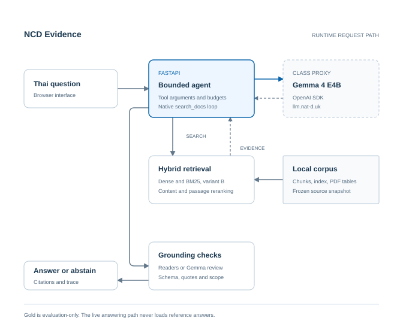
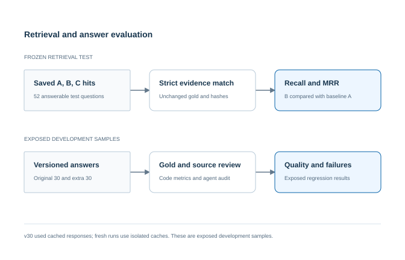

# NCD Evidence

ระบบถามตอบจากเอกสาร NCD ภาษาไทย ช่วยค้นและสรุปหลักฐานพร้อมชื่อเอกสาร ฉบับพิมพ์ เลขหน้า และข้อความอ้างอิง ผู้ใช้จึงกลับไปตรวจที่มาของคำตอบได้ ใช้ `gemma-4-E4B-it` ผ่าน class proxy ของรายวิชา โดยต่อยอด corpus, gold และ retrieval จาก [Thai NCD Guideline QA](https://github.com/Chaiporn2005/thai-ncd-guideline-qa)

โครงงานรายวิชา **Building LLM-Powered Applications** จัดทำโดย **นายธนกฤต เสมอหน้า รหัสนักศึกษา 6707060** ผู้สอน **ดร. ณัฏฐ์ ดิลกธนากุล**

แอปมีขอบเขตเป็นผู้ช่วยอ่านเอกสาร ไม่ใช้วินิจฉัยหรือจัดแผนรักษาเฉพาะบุคคล หากหลักฐานไม่พอจะงดตอบหรือขอรายละเอียดเพิ่ม คำทักทายล้วนตอบด้วยข้อความระบุขอบเขตโดยไม่เรียกโมเดล

อ่าน [วิธีรัน](#เริ่มใช้งาน), [ผลการประเมิน](#ผลการประเมิน), [รายงานโครงงาน](docs/PROJECT_REPORT_TH.md) และ [เทคนิคกับการนำงานเดิมมาใช้](docs/WORKFLOW_AND_REUSE_TH.md)

## ระบบทำงานอย่างไร



1. หน้าเว็บส่งคำถามไปยัง FastAPI และ agent บังคับให้ Gemma เริ่มด้วย native `search_docs` สำหรับคำถามในขอบเขต
2. โค้ดตรวจชื่อ tool และ arguments จากนั้นค้นด้วย dense search และ BM25 ตาม frozen variant B ผลค้นผ่านการต่อบริบท การอ่านตาราง และ passage reranking
3. หลักฐานที่ส่งให้โมเดลมี source IDs, passage IDs, edition และเลขหน้า ส่ง tool result กลับพร้อม `tool_call_id` ที่ตรงกับคำขอ
4. หากพบความสัมพันธ์ที่ source bound reader ตรวจได้ครบ ระบบอ่านค่าจากหลักฐานโดยตรง หากไม่ครบจะใช้ Gemma สร้างคำตอบและตรวจอีกครั้ง ทุกเส้นทางต้องผ่าน schema และ citation validation รวมถึง guard ที่เกี่ยวข้อง
5. หน้าเว็บแสดงคำตอบหรือเหตุผลที่งดตอบ พร้อมหลักฐานและ trace ให้ตรวจขั้นตอนย้อนหลังได้

กล่อง Grounding checks ในภาพรวม source bound readers และเส้นทาง Gemma review เข้าด้วยกัน รายละเอียดอยู่ใน [workflow](docs/WORKFLOW_AND_REUSE_TH.md) **Gold และ reference answers ใช้เฉพาะ evaluation runner ไม่มีการโหลดเพื่อช่วยตอบใน serving layer**

| การออกแบบ | ค่าและเหตุผล |
|---|---|
| LLM | OpenAI SDK, `https://llm.nat-d.uk/v1`, `gemma-4-E4B-it`, temperature 0 |
| Retrieval หลัก | bge-m3 child 128 tokens, parent 512 tokens และ BM25 char3 |
| การรวมคะแนน | Min-max convex fusion, alpha 0.6, pool 100, BM25 k1 2.18 และ b 0.86 จาก frozen config เดิม |
| บริบทเพิ่มเติม | Neighbour context, PDF table cells และ short passages เรียงด้วย bge-reranker-v2-m3 |
| ขอบเขต agent | Configuration ที่ประเมินใช้ไม่เกิน 6 model rounds รวม review, 3 searches, top_k 8 และ context 18,000 ตัวอักษร |
| การหยุดและซ่อม | Request timeout 45 วินาที เวลารวม 150 วินาที ซ่อมภายใน budget เดิมและงดตอบเมื่อยังตรวจไม่ได้ |
| ขอบเขต tool | อนุญาตเฉพาะ `search_docs` ตรวจ filters, arguments และ query ซ้ำ ไม่เปิด shell ให้โมเดล |

## ผลการประเมิน

แยกคุณภาพการค้นหลักฐานออกจากคุณภาพคำตอบ เพื่อไม่ใช้คะแนน retrieval แทนความถูกต้องของ Gemma



### 1. Retrieval เทียบ baseline

Corpus `normalized-v12` มี 66 เอกสารที่มี chunks, child chunks 23,819 ชิ้น และ parent chunks 4,347 ชิ้น ไฟล์คำถามมี 177 แถว ใช้ gold 162 ข้อ แบ่งเป็น dev 106 และ test 56 ข้อ อีก 15 แถวเป็น rejected และไม่ใช้ประเมิน

ตารางนี้ใช้ **test ที่ตอบได้ 52 ข้อ** จากทั้งหมด 56 ข้อ กำหนด **A dense parent-child** เป็น baseline และคำนวณใหม่จาก saved ranked hits โดยตรวจ hashes ก่อนทุก run

| ระบบ | Strict Recall@5 | Strict MRR@10 |
|---|---:|---:|
| A dense baseline | 0.8077 | 0.6181 |
| B hybrid ที่นำมาใช้ในแอป | 0.8846 | 0.7374 |
| C hybrid และ reranker จากการทดลองเดิม | 0.9135 | 0.7706 |

B เพิ่ม Recall@5 **7.69 percentage points** และ MRR@10 **0.1193** เมื่อเทียบ A โดย Recall วัดความครอบคลุมของหลักฐาน ส่วน MRR วัดอันดับของหลักฐานที่เกี่ยวข้องรายการแรก การจับคู่แบบ strict ตรวจ edition ช่วงหน้า และ quote ตาม protocol เดิม

ผลนี้เป็น **frozen retrieval replay** จากงานเดิมซึ่งทีมเคยเห็นผลแล้ว ไม่ได้รัน test retrieval ใหม่ แอปเพิ่ม passage reranking ในขั้นเตรียมบริบท ซึ่งเป็นคนละ pipeline กับ C จึงไม่อ้างคะแนน C เป็นผลของแอปหรือเป็น answer accuracy

หลักฐาน: [retrieval metrics](reports/retrieval_metrics.json), [evaluation implementation](src/ncd_gemma/evaluation.py), [frozen configurations](configs)

### 2. คุณภาพคำตอบใน dev ชุดเดิม 30 ข้อ

ล็อกคำถามหกประเภทอย่างละ 5 ข้อ ได้แก่ condition, fact, multi_page, number_unit, table และ unanswerable ชุดนี้มีข้อที่ตอบได้ 25 ข้อและควรงดตอบ 5 ข้อ ใช้คำถามเดิมเปรียบเทียบระหว่างรุ่น และตรวจสาระกับ gold และหลักฐานโดย coding agent

| ผลในกลุ่ม answerable 25 ข้อ | v13 | v24 | v26 | v27 | v30 |
|---|---:|---:|---:|---:|---:|
| คำตอบที่ตรวจว่าได้สาระครบ | 14 | 21 | 25 | 24 | 25 |
| ตอบผิด ไม่ครบ หรือต้องทบทวน | 9 | 2 | 0 | 1 | 0 |
| งดตอบเกินจำเป็น | 2 | 2 | 0 | 0 | 0 |
| Citation primary evidence hit rate | 0.5600 | 0.6000 | 0.6400 | 0.7200 | 0.7200 |
| Mean character F1 | 0.2805 | 0.3464 | 0.4217 | 0.4265 | 0.4453 |

v30 ได้สาระครบเพิ่มจาก v13 **11 ข้อ** และงดตอบตรง label อีก **5 ข้อ** จาก 5 ข้อที่ตอบไม่ได้ Abstention decision accuracy จึงเท่ากับ **1.0000** แต่ metric นี้วัดการเลือกตอบหรืองด ไม่ได้วัดความถูกต้องทุกประโยค Citation hit วัดการอ้าง primary evidence ของ gold และอาจไม่ครอบคลุมหลักฐานทางเลือก ส่วน Character F1 วัด text overlap

หลักฐาน: [metrics รุ่นปัจจุบัน](reports/gemma_dev_metrics.json), [semantic audit](reports/semantic_audit.json), [ผลรายข้อ](docs/DEV_COMPARISON_TH.md), [ประวัติทุกรุ่นรวมรุ่นที่แย่ลง](reports/history)

### 3. Extra-dev อีก 30 ข้อ

ชุดเพิ่มเติมไม่ซ้ำ 30 ข้อเดิม มีคำถามที่ตอบได้ 26 ข้อและควรงดตอบ 4 ข้อ v26 เป็นรอบแรกของชุดนี้ หลังเปิดผลแล้วจึงใช้ข้อผิดพลาดปรับระบบ

| รุ่น | ถูกทั้งหมด รวมงดถูก | ตอบถูก | งดถูก | งดเกินจำเป็น | ผิดหรือไม่ครบประเภทอื่น |
|---|---:|---:|---:|---:|---:|
| v26 | 19/30 | 17 | 2 | 6 | 5 |
| v28 | 27/30 | 23 | 4 | 3 | 0 |
| v29 | 30/30 | 26 | 4 | 0 | 0 |
| v30 | 30/30 | 26 | 4 | 0 | 0 |

**ผลหลังปรับเป็น exposed regression ไม่ใช่ unseen test** การ replay v30 ใช้ model responses จาก cache และบันทึก API calls ใหม่เป็น 0 คำตอบ สถานะและ citations ตรงกับ v29 ทั้งสองชุด จึงไม่ใช่การทดลองสร้างคำตอบใหม่ และ semantic audit เป็นการตรวจโดย coding agent ไม่ใช่ผู้เชี่ยวชาญอิสระ ยังไม่มี ablation ที่แยกผลของแต่ละเทคนิค

หลักฐาน: [v26](reports/extra_dev_v26_semantic_audit.json), [v28](reports/extra_dev_v28_semantic_audit.json), [v29](reports/extra_dev_v29_semantic_audit.json), [v30](reports/extra_dev_v30_semantic_audit.json)

## ข้อผิดพลาดที่พบและสิ่งที่ยังต้องพัฒนา

| กรณี | สิ่งที่พบ | วิธีแก้และผลตรวจ |
|---|---|---|
| q076 ใน v13 | ใช้ค่า 150 นาทีจากบริบทใกล้เคียง แทนช่วง 150 ถึง 300 นาทีที่โจทย์ถาม | รักษาช่วงค่า หน่วยและเงื่อนไขใน claim; v30 ผ่านการตรวจ dev เดิม |
| q108 ใน v27 | อธิบายโซเดียมไม่ครบด้านอาหารกระป๋อง | ผูก reader กับหลักฐานที่มีทั้งบริบทการเติมเกลือและ MSG; แก้กลับใน v28 |
| q006, q107, q110 ใน extra-dev v28 | พบหลักฐานแล้วแต่ยังงดตอบ | เพิ่ม reader สำหรับตารางและความสัมพันธ์ที่ตรวจได้ตรง; v29 ตอบได้ครบและ v30 ให้ผลเดิม |
| คำถาม “เป็นโรคไต ควรงดกินอะไร” | ข้อมูลกว้างเกินกว่าจะกำหนดข้อจำกัดเฉพาะบุคคล | รองรับคำแนะนำทั่วไปที่มีหลักฐานและขอรายละเอียดเพิ่ม แยกเงื่อนไขก่อนล้างไตกับผู้ที่ล้างไตแล้ว |

สิ่งที่ยังไม่ยืนยันคือคุณภาพบนคำถามใหม่ โดยเฉพาะการเปลี่ยนสำนวน ประชากร เงื่อนไขและคำปฏิเสธ การมี quote จริงไม่ได้พิสูจน์ว่าทุก claim ถูกต้อง และ reviewer ที่ใช้ Gemma ตัวเดียวกับผู้ตอบอาจผิดพร้อมกันได้ Source bound readers ช่วยในรูปแบบที่รองรับ แต่ยังไม่ใช่ตัวตรวจความหมายทั่วไป

งานต่อไปคือประเมินชุดใหม่หลังล็อก implementation จัด blind review โดยผู้เชี่ยวชาญ ทำ ablation ของ reader และ reranker และวัด latency กับค่าใช้จ่ายจาก fresh requests ก่อนสรุปผลเชิงใช้งานจริง

## เริ่มใช้งาน

Environment ที่ตรวจคือ **Windows และ Python 3.12.13** ใช้ CPU ได้ ต้องมี RAM สำหรับ embedding model, reranker และ index ส่วน model cache ใช้พื้นที่ประมาณ 6.4 GiB การโหลดครั้งแรกบนเครื่องที่ตรวจเคยใช้เวลาประมาณ 5 นาที ซึ่งไม่ใช่ latency ต่อคำถาม

### 1. Clone และติดตั้ง

```powershell
git clone https://github.com/Up2mEz/LLM-APP-END2END.git
cd LLM-APP-END2END
py -3.12 -m venv .venv312
.venv312\Scripts\python -m pip install -r requirements-runtime.txt
Copy-Item .env.example .env
```

ตั้งค่าจาก class proxy ใน `.env` โดยไม่ commit key และไม่ส่ง key เข้า frontend

```dotenv
OPENAI_BASE_URL=https://llm.nat-d.uk/v1
OPENAI_API_KEY=your-class-proxy-key
NCD_MODEL=gemma-4-E4B-it
```

เก็บค่า budget อื่นตาม `.env.example` แอปตรวจ endpoint ว่าเป็น class proxy ที่กำหนด และอ่าน `.env` ของโปรเจกต์ทับตัวแปรชื่อเดียวกันที่สืบทอดจาก shell

### 2. ดาวน์โหลดข้อมูลและเตรียมโมเดล

```powershell
.venv312\Scripts\python -B scripts/public_data.py fetch
$env:HF_HUB_OFFLINE = '0'
.venv312\Scripts\python -B scripts/prepare_models.py
$env:HF_HUB_OFFLINE = '1'
$env:PYTHONPATH = "$PWD\src"
.venv312\Scripts\python -B -m ncd_gemma.cli doctor --retrieval
```

`fetch` ดาวน์โหลด [data-v12 release](https://github.com/Up2mEz/LLM-APP-END2END/releases/tag/data-v12) และตรวจ archive hash พร้อม hashes ของทั้ง 34 ไฟล์ตาม [release manifest](provenance/public_data_release.json) ชุดข้อมูลมี extracted corpus, index, gold, frozen ranked hits และ table context จึงไม่ต้องเข้าถึง repository ต้นทางในเครื่อง ไม่มี PDF ต้นฉบับ, model weights, API key หรือ private model responses ใน archive

Model revisions ที่ตรึงไว้คือ `BAAI/bge-m3` ที่ `5617a9f61b028005a4858fdac845db406aefb181` และ `BAAI/bge-reranker-v2-m3` ที่ `953dc6f6f85a1b2dbfca4c34a2796e7dde08d41e` หลังเตรียม cache แอปใช้ offline mode เพื่อไม่เปลี่ยน weights ระหว่างรัน

### 3. เปิดแอป

```powershell
.\run.ps1
```

เปิด [แอปในเครื่อง](http://127.0.0.1:8765/) รอโหลด retrieval ในคำถามแรก คำถามถัดไปใช้ instance เดิม ระบบรับงานครั้งละหนึ่งคำถามเพื่อจำกัดทรัพยากร ลองคำถามเฉพาะ เช่น “เป้าหมาย HbA1c ตามแนวทางคือเท่าไร” แล้วตรวจว่าคำตอบอ้างกลุ่มและเงื่อนไขใดในเอกสาร

## ตรวจและทำซ้ำผลการทดลอง

| งาน | คำสั่งหลังตั้ง PYTHONPATH | สิ่งที่คำสั่งยืนยัน |
|---|---|---|
| Unit และ API tests | `.venv312\Scripts\python -B -m pytest -q` | พฤติกรรมโค้ดด้วย fake model และ retriever |
| Frozen retrieval replay | `.venv312\Scripts\python -B -m ncd_gemma.cli evaluate retrieval` | คำนวณ metrics จาก saved hits และตรวจ hashes ไม่มี LLM calls |
| ตรวจ retrieval จริง | `.venv312\Scripts\python -B -m ncd_gemma.cli doctor --retrieval` | โหลด model และค้น local index จริง |
| ตรวจ class proxy | `.venv312\Scripts\python -B -m ncd_gemma.cli doctor --live` | เรียก class proxy จริง ต้องมี key |
| ตรวจแผน dev | `.venv312\Scripts\python -B -m ncd_gemma.cli evaluate plan` | ตรวจ 30 ข้อและ implementation hashes; ปฏิเสธเมื่อไม่ตรงแผนที่บันทึก |
| ประเมินคำตอบตามแผน | `.venv312\Scripts\python -B -m ncd_gemma.cli evaluate agent` | ต้องผ่านการตรวจแผนก่อน จึงเรียก class proxy หรือใช้ cache และ resume |
| ตรวจ clean clone และ release | `.venv312\Scripts\python -B scripts/smoke_remote_release.py` | Clone main, fetch และ replay frozen retrieval 6 runs |

ผล aggregate อยู่ใน `reports/` ส่วนคำตอบดิบพร้อมหลักฐานอยู่ใน `private/runs/` และ response cache อยู่ใน `.cache/llm/` สองส่วนหลังถูก Git ignore การประเมินซ้ำอาจ resume หรือใช้ cache จึงต้องอ่าน plan ID และ `new_api_calls_recorded` ประกอบ ไม่ตีความทุก invocation ว่าเป็นการสร้างคำตอบใหม่

**ตรวจซ้ำ 14 ตุลาคม 2026: 170 tests passed ไม่มี failure, error หรือ skipped** มี Starlette deprecation warning หนึ่งรายการ ดู [บันทึกทดสอบรอบจัดทำรายงาน](reports/documentation_tests_2026-10-14.json) การรันใน Windows sandbox ค้างขณะสร้าง socketpair ของ TestClient จึงยืนยันผลนอก sandbox โดยไม่แก้โค้ดระบบ

ผล fresh clone และ public release เคยตรวจครบเมื่อ 12 ตุลาคม 2026 ส่วนผลคำตอบ v30 เกิดก่อนการเพิ่ม connection retry และการตั้งค่าสำหรับ deployment ขณะนี้ hashes ของ `llm.py` และ `config.py` ไม่ตรงแผน v30 ดังนั้นคำสั่งตรวจแผนและประเมินคำตอบจะหยุดด้วย `Existing plan differs` ตาม guard ที่ตั้งใจไว้ ต้องสร้าง evaluation version ใหม่โดยเก็บแผนและผลเดิมไว้ก่อนรันใหม่ ไม่ลบแผนเพื่ออ้างว่าเป็น v30 เดิม **การทำซ้ำ frozen retrieval ยังทำได้ตามคำสั่งข้างต้น** ผล unit tests ต้องอ่านแยกจากผลคำตอบ

## ส่วนที่นำมาใช้และส่วนที่ทำเพิ่ม

| นำมาจาก Thai NCD Guideline QA | พัฒนาในโครงงานนี้ |
|---|---|
| Corpus, gold และ split เดิม | OpenAI SDK adapter สำหรับ class proxy |
| Child และ parent chunks, document vectors | Native tool calling และ bounded agent loop |
| Dense search, BM25, fusion และ frozen A/B/C runs | Neighbour context, passage reranking และ table context |
| Retrieval schemas และ evaluation protocol | Source bound readers, claim rendering, citation และ scope guards |
| Metadata และ provenance ของทีม | FastAPI, UI ภาษาไทย, answer evaluation และ regression tests |

สำเนาโค้ดและข้อมูลอยู่ใน repository นี้ ไม่มี runtime import หรือ write ไปที่ repository ต้นทาง ไม่แก้ gold เพื่อให้ผลดีขึ้น รายการ 48 ไฟล์ที่นำเข้าและ hashes อยู่ใน [source snapshot](provenance/source_snapshot.json) ส่วนรายละเอียดเทคนิคทั้งหมดอยู่ใน [workflow และ reuse](docs/WORKFLOW_AND_REUSE_TH.md)

ผู้จัดทำยืนยันสิทธิ์เผยแพร่และโฮสต์ corpus ชุดนี้แล้ว เอกสารขอบเขตการอนุญาตไม่ได้แนบใน repo และ manifest สิทธิ์จากต้นทางยังเป็น snapshot เก่า การอ้างอิงต้นทางและเอกสารผู้เผยแพร่ยังคงจำเป็น

## ความครบถ้วนตามโจทย์ Project

| ข้อกำหนด | สิ่งที่มีให้ตรวจ |
|---|---|
| Corpus ของโดเมนตนเอง | เอกสาร NCD ภาษาไทย และ public data fetch script |
| Evaluation set ประมาณ 30 ตัวอย่าง | Dev 30 ข้อ และ extra-dev 30 ข้อ พร้อมแผนและผลรายรุ่น |
| Baseline และ measured improvement | A dense เทียบ B hybrid พร้อม Recall@5 และ MRR@10 |
| Family 1: structured output | Pydantic schemas และ bounded repair |
| Family 2: retrieval และ RAG | Hybrid retrieval พร้อมหลักฐานและ citations |
| Family 3: retrieval evaluation | Frozen labelled test, metrics และ reproduction script |
| Family 4: agent loop | Native `search_docs`, argument validation และ stop conditions |
| Family 6: served interface | FastAPI และหน้าเว็บภาษาไทย |
| รายงาน 4 ถึง 8 หน้า | [รายงานฉบับอ่านบน GitHub](docs/PROJECT_REPORT_TH.md) และ PDF 7 หน้าที่สร้างจากแหล่งเดียวกัน |
| Demo | แอปในเครื่องและ temporary HTTPS demo; [แนวทางสาธิต](docs/DEMO_SCRIPT_TH.md) |

แผนภาพใช้สกิล Diagram Design มี [ต้นฉบับ HTML และบันทึกการย่อรายละเอียด](docs/diagrams/README.md) ผู้ตรวจสามารถไล่จากภาพไปยัง [agent](src/ncd_gemma/agent.py), [retrieval wrapper](src/ncd_gemma/retrieval.py), [source bound readers](src/ncd_gemma/grounded_routes.py) และ [server](src/ncd_gemma/server.py) ได้

## Demo และการโฮสต์

Temporary demo ใช้ Cloudflare Quick Tunnel ซึ่งต้องเปิดเครื่อง แอปและ tunnel ค้างไว้ URL เปลี่ยนได้เมื่อเริ่มใหม่ จึงส่งลิงก์ปัจจุบันและรหัสเข้าถึงให้ผู้ตรวจแยกจาก repository ไม่ใช่ deployment ถาวร

มี `Dockerfile` สำหรับ Python 3.12 และ CPU models แต่ **ยังไม่ยืนยัน full build และ runtime บน Linux host** หากนำไปโฮสต์ ให้ตั้ง `OPENAI_API_KEY`, `OPENAI_BASE_URL`, `NCD_PUBLIC_HOST` เป็น hostname จริงแบบไม่มี `https://` และ `NCD_DEMO_PASSWORD` อย่างน้อย 12 ตัวอักษร โดย `NCD_DEMO_USER` มีค่าเริ่มต้นเป็น `demo` หน้าเว็บและ API ใช้ Basic Auth ยกเว้น health check และต้องเข้าผ่าน HTTPS เก็บ secrets ใน host และส่งรหัสให้ผู้ตรวจแยกจาก repository

## โครงสร้าง repository

| ที่อยู่ | หน้าที่ |
|---|---|
| `src/ncd_gemma/` | Agent, adapter, validation, API และ evaluation |
| `src/ncdqa/` | Retrieval modules ที่นำมาใช้จากต้นทาง |
| `static/` | หน้าเว็บภาษาไทยและ stylesheet |
| `configs/`, `schemas/` | Frozen retrieval config และ schemas |
| `scripts/` | Fetch, integrity checks, model preparation และการสร้างรายงาน |
| `tests/` | Unit, protocol, failure และ API tests |
| `reports/` | ผล aggregate และ semantic audits |
| `docs/` | รายงาน workflow ผลรายข้อ และแผนภาพ |
| `provenance/` | Source hashes, attribution และ public release manifest |
| `data/` | Local data ที่ fetch จาก release และถูก Git ignore |
| `private/`, `.cache/` | Raw responses และ cache ที่ไม่เผยแพร่ |

รายงาน PDF สร้างด้วย `python scripts/build_report.py` ใน environment ที่มี ReportLab, HarfBuzz และ Tahoma บน Windows ไฟล์อยู่ที่ `output/pdf/NCD_GEMMA_PROJECT_REPORT_TH.pdf` และถูก Git ignore ต้นฉบับเนื้อหาอยู่ใน [build_report.py](scripts/build_report.py) โดยตารางผลอ่านจาก JSON ที่บันทึกจริง

## เอกสารอ้างอิง

1. [Thai NCD Guideline QA](https://github.com/Chaiporn2005/thai-ncd-guideline-qa): ข้อมูลและ retrieval snapshot ของทีม อ้างอิง commit ที่ตรวจและ hashes ใน provenance ไม่อ้างว่าสร้างส่วนนี้ใหม่ทั้งหมด
2. [Project specification](https://courses.nat-d.uk/courses/building-llm-powered-applications/courseworks/20): class proxy, capability families, evaluation, รายงานและ demo ตามโจทย์ที่บันทึกเมื่อ 11 ตุลาคม 2026
3. [OpenAI function calling](https://developers.openai.com/api/docs/guides/function-calling): assistant tool calls และ tool results
4. [Gemma function calling](https://ai.google.dev/gemma/docs/capabilities/text/function-calling-gemma4): รูปแบบ function arguments ที่ adapter รองรับแบบจำกัด โดยไม่ใช้ `eval`
