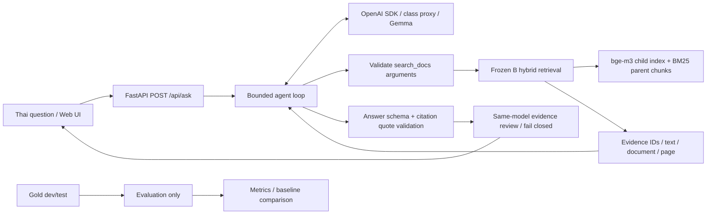

# NCD Evidence: Gemma ผ่าน class proxy

แอปถามตอบจากเอกสาร NCD ภาษาไทย ใช้ gold และ retrieval snapshot จาก Thai NCD Guideline QA แล้วต่อ `gemma-4-E4B-it` ผ่าน OpenAI SDK พร้อม native `search_docs` tool และ agent loop หน้าสาธิตแสดงคำตอบ ข้อความอ้างอิง เลขหน้า และ trace

โปรเจคนี้อยู่แยกจากต้นทางใน `D:\KMITL\LLMapp\ncd-gemma` ข้อมูลที่นำเข้าเป็นสำเนา ไม่มี runtime import หรือ write ไปที่ repository ต้นทาง

## เริ่มใช้งานบนเครื่องนี้

```powershell
cd D:\KMITL\LLMapp\ncd-gemma
.\run.ps1
```

เปิด `http://127.0.0.1:8765` การถามครั้งแรกจะโหลด bge-m3 และ index เข้า memory ครั้งต่อไปใช้ instance เดิม API รับคำถามครั้งละหนึ่งคำถามเพื่อจำกัดทรัพยากร การตรวจครั้งแรกบนเครื่องนี้ใช้เวลาโหลดประมาณ 298 วินาที และค้นหลักฐานจริงได้ 3 รายการ หากต้องการดูขั้นตอนโหลด ให้ตั้ง `$env:NCD_DEBUG_STARTUP='1'` ก่อนรัน

## ติดตั้งใน environment ใหม่

Environment ที่ทดสอบใช้ Python 3.12.13 และ CPU RAM เพียงพอสำหรับ bge-m3/index ไม่ต้องมี GPU

```powershell
py -3.12 -m venv .venv312
.venv312\Scripts\python -m pip install -r requirements-runtime.txt
Copy-Item .env.example .env
```

ตั้ง `OPENAI_API_KEY` และ `OPENAI_BASE_URL` เป็นค่าจาก class proxy ใน `.env` ไม่ส่ง key เข้า frontend และไม่ commit `.env` โมเดลถูกกำหนดเป็น `gemma-4-E4B-it` แอปตรวจ endpoint ว่าเป็น `https://llm.nat-d.uk` จึงไม่เผลอใช้ key กับบริการอื่น การอ่าน `.env` ของโปรเจคนี้จะ override ตัวแปรชื่อเดียวกันที่สืบทอดมาจาก shell

นำข้อมูลที่มีสิทธิ์ใช้จาก local repository เข้ามา:

```powershell
python scripts/import_source.py --source "D:\KMITL\NLP\NLP-Year3\team-project\thai-ncd-guideline-qa"
```

สคริปต์อ่าน allow-list 48 ไฟล์ ตรวจ SHA-256 ก่อนและหลัง copy และปฏิเสธการเขียนทับไฟล์ปลายทางที่เปลี่ยนไป ข้อมูลอยู่ใต้ `data/` ซึ่ง Git ignore ไว้ทั้งหมด ไม่มี secret ถูกคัดลอกด้วยสคริปต์นี้ ดูรายการต้นทางและ hashes ใน `provenance/source_snapshot.json`

ต้องมี Hugging Face cache ของ `BAAI/bge-m3` revision `5617a9f61b028005a4858fdac845db406aefb181` และ `refs/main` ของ cache ต้องตรง revision นี้ แอปตั้ง offline mode โดย default เพื่อไม่เปลี่ยน weights ระหว่างรัน หากติดตั้งเครื่องใหม่ ให้เตรียม cache revision นี้จากผู้ให้บริการโมเดลด้วยกระบวนการที่บันทึก version ชัดเจนก่อน การเปลี่ยน answer LLM ไม่ต้องสร้าง document vectors ใหม่

## คำสั่งตรวจและประเมินผล

```powershell
$env:PYTHONPATH = "$PWD\src"
.venv312\Scripts\python -B -m ncd_gemma.cli doctor
.venv312\Scripts\python -B -m ncd_gemma.cli doctor --retrieval
.venv312\Scripts\python -B -m ncd_gemma.cli doctor --live
.venv312\Scripts\python -B -m pytest -q
.venv312\Scripts\python -B -m ncd_gemma.cli evaluate retrieval
.venv312\Scripts\python -B -m ncd_gemma.cli evaluate plan
.venv312\Scripts\python -B -m ncd_gemma.cli evaluate agent
```

`doctor --live` และ `evaluate agent` เรียก class proxy จริง `evaluate retrieval` คำนวณ metrics จาก saved ranked hits และตรวจ hash ไม่เรียกโมเดลหรือรัน test retrieval ใหม่ `evaluate plan` ล็อก dev sample 30 ข้อก่อนเรียกโมเดล แผนผูกกับ hashes ของ agent, verifier, adapter, schemas, config และ retrieval wrapper การเปลี่ยน implementation คำถามหรือ prompt หลังมีแผนต้องสร้าง version ใหม่ ไม่ปรับแผนตามผล

ผล aggregate อยู่ใน `reports/` ผลคำตอบพร้อมหลักฐานอยู่ใน `private/runs/` และ raw model cache อยู่ใน `.cache/llm/` ทั้งสองโฟลเดอร์ถูก ignore การรัน agent evaluation ซ้ำ resume จาก qid ที่มีอยู่แล้ว ไม่เรียก API ซ้ำโดยไม่จำเป็น Cache เก็บ response เต็มรวม tool calls และผูกกับ endpoint identity, model, messages, tools และ parameters

## โครงสร้าง

```text
src/ncd_gemma/     app, SDK adapter, validation, agent loop, evaluation
src/ncdqa/        สำเนา retrieval modules จากโปรเจคเดิม
configs/          frozen retrieval configuration
static/           หน้าเว็บภาษาไทย ไม่มี external scripts/fonts
schemas/          question/retrieval schemas จากต้นทาง
scripts/          import และเครื่องมือทำเอกสาร
tests/            protocol, citation, failure และ API tests
data/             corpus/index/gold/frozen runs (private, ignored)
reports/          aggregate metrics และเอกสารผลทดสอบ
private/          คำตอบจริงและ evidence (ignored)
provenance/       hashes และ attribution
```

## Architecture และขอบเขต tool



Gold ไม่ถูกโหลดโดย serving layer และไม่มี reference answers ถูกส่งให้ Gemma ฝั่ง retrieval ใช้ child 128 tokens, parent 512 tokens, bge-m3, BM25 char3, k1=2.18, b=0.86 และ min-max convex fusion alpha=0.6, pool=100 ตาม frozen config เดิม

Agent บังคับเริ่มด้วย `search_docs` จากนั้นเลือกค้นเพิ่มหรือตอบได้เอง เก็บ assistant tool calls และส่ง tool result กลับพร้อม `tool_call_id` ที่ตรงกัน จำกัด 4 model rounds รวม verification, 3 searches, top_k ไม่เกิน 8 และ context รวม 18,000 ตัวอักษร ปฏิเสธ query/filter ซ้ำ ชื่อ tool อื่น และ filter ที่ไม่มีใน metadata รอบสุดท้ายปิดการเรียก tools มี request timeout และ agent deadline

Final answer ผ่าน Pydantic schema มีสถานะ answered หรือ insufficient_evidence ทุก citation ต้องอ้าง source ID ที่ tool ส่งมาจริง quote ต้องอยู่ในข้อความที่ model เห็น และ citation markers ในคำตอบต้องตรงกับรายการอ้างอิง ถ้าผิดให้แก้ได้หนึ่งรอบ แล้วหยุดอย่างชัดเจน การตรวจนี้ยืนยันที่มาของ quote ไม่ได้พิสูจน์ความหมายของคำตอบทุกประโยค

## ผล retrieval และ baseline

ผลจาก saved frozen test มี 56 gold questions เป็น answerable 52 และ unanswerable 4 ข้อ ค่าเฉลี่ยต่อไปนี้ใช้ 52 ข้อที่ตอบได้

| ระบบ | Strict Recall@5 | Strict MRR@10 |
|---|---:|---:|
| A dense parent-child (baseline) | 0.8077 | 0.6181 |
| B hybrid parent-child (แอปเลือกใช้) | 0.8846 | 0.7374 |
| C hybrid + reranker (ผลทดลองเดิม) | 0.9135 | 0.7706 |

B เพิ่ม Recall@5 7.69 percentage points และ MRR@10 0.1193 เมื่อเทียบ A ไม่ใช้ C ในแอปนี้เพื่อลดภาระ inference ของ reranker ผลนี้เป็น retrieval quality เดิม ไม่ใช่ answer accuracy หรือผลของ agent ที่เปลี่ยน query เอง

ชุดข้อมูลมี 177 แถว ใช้ gold 162 ข้อ (dev 106/test 56) และตัด rejected 15 ข้อ ผล agent evaluation ใช้ dev sample ที่ล็อก 30 ข้อ เป็น development result แยกจาก frozen test มี abstention decision accuracy, citation primary-evidence coverage และ character F1 โดย character F1 เป็นเพียง text overlap ไม่ใช่ความถูกต้องทางคลินิก ดูผลรันจริงและข้อจำกัดใน `reports/gemma_dev_metrics.json` เมื่อ evaluation เสร็จ

## สิ่งที่ตรงกับโจทย์ Project

| Capability | Implementation |
|---|---|
| 1 Structured output | Pydantic answer/tool schemas + bounded repair |
| 2 Retrieval/RAG | Frozen hybrid retrieval + evidence/citations |
| 3 Retrieval evaluation | Gold labels + reproducible saved-hit metrics + A/B baseline |
| 4 Agentic tool calling | Gemma native search_docs loop + stop conditions |
| 6 Served interface | FastAPI REST API + Thai browser UI |

มี incremental Git commits สำหรับงานนี้ อ่าน proposal และ demo script ใน `docs/` และรายงานผลจริงใน `reports/` ตั้ง origin เป็น https://github.com/Up2mEz/LLM-APP-END2END แล้ว ยังไม่ได้ push ตามขอบเขตใช้ corpus ในเครื่องก่อน ต้องตรวจความพร้อมของ public corpus/repository และส่ง PDF/demo URL ตามรายการส่งจริง

## สถานะการตรวจล่าสุด

- Unit/API tests ผ่าน **68 ข้อ** ไม่มี failed/error/skipped มี Starlette deprecation warning 1 รายการ
- Gemma dev ชุดเดิม 30 ข้อ รุ่น **v8**: ตอบ 11 ข้อ งดตอบ 19 ข้อ ในข้อที่งดตอบมี 14 ข้อที่ gold ระบุว่าตอบได้
- Abstention decision accuracy **0.5333**, citation primary-evidence hit rate **0.3200**, character F1 **0.1319** ไม่ใช่ clinical accuracy
- เพิ่ม structured review แยกประเด็น ตรวจ quote จากคำตอบและ evidence, bounded repair ภายใน 4 calls และตรวจคำถามที่ถาม “กี่” แต่ไม่มีจำนวนในคำตอบ
- ระงับคำตอบผิดเดิม q113/q080 และคำตอบไม่ครบ q120 ได้ แต่ทำให้คำตอบเดิมที่ตรง reference 4 ข้อถูกงดตอบเพิ่ม จึง **ไม่อ้างว่า overall accuracy ดีขึ้น** ดู [ผลตรวจทั้ง 30 ข้อ](docs/ANSWER_REVIEW_TH.md)
- คำตอบที่ยังต้องทบทวนคือ q041 (alternative source/คำถามกำกวม) และ q076 (ช่วงจำนวนไม่ครบและต่างบริบท)
- UI โทนฟ้า–ขาวตาม Hallmark, mascot หนังสือ, copy/clear/help/source disclosure และ reduced motion มีการแยกสถานะ “ยังยืนยันคำตอบไม่ได้” ออกจากการไม่พบหลักฐาน
- Browser ทดสอบ success q045 และการระงับ q113/q120 บน v8; model completions ใช้ cache จริง ส่วน retrieval ทำงานจริง
- Frozen retrieval metrics ตรงเดิมทั้ง 6 runs; hashes ต้นทาง 48 ไฟล์ไม่เปลี่ยน

| Dev 30 ข้อเดิม | v5 ก่อนเพิ่ม checks | v6 checks ยังไม่มี repair | v7 เพิ่ม repair | v8 ปัจจุบัน |
|---|---:|---:|---:|---:|
| ตอบ / งดตอบ | 18 / 12 | 4 / 26 | 12 / 18 | 11 / 19 |
| Abstention decision accuracy | 0.7000 | 0.3000 | 0.5000 | 0.5333 |
| Citation primary-evidence hit rate | 0.5200 | 0.1200 | 0.3200 | 0.3200 |
| Character F1 | 0.2344 | 0.0329 | 0.1319 | 0.1319 |
| ตอบข้อที่ label เป็น unanswerable | 1 | 1 | 1 | 0 |

ผลนี้สะท้อน trade-off: ต้นแบบปัจจุบันยืนยันได้ยากขึ้นและงดตอบมากขึ้น ไม่ใช่การพิสูจน์ว่าระบบมีคุณภาพโดยรวมสูงขึ้น รุ่น v6–v8 ใช้ candidate responses ที่ cache ไว้เมื่อ payload ตรงกัน; new API calls ที่บันทึกคือ 21, 15 และ 0 ตามลำดับ เก็บ raw runs และผลเก่าครบ เปรียบเทียบด้วย `python scripts/compare_agent_runs.py`

อ่าน [สถานะตาม rubric และงานส่งที่เหลือ](docs/PROJECT_READINESS_TH.md) และ [ผลตรวจดีไซน์](docs/UI_REVIEW_TH.md) รายงาน PDF สร้างจาก artifacts จริงด้วย `.venv312\Scripts\python scripts/build_report.py` ที่ `output/pdf/NCD_GEMMA_PROJECT_REPORT_TH.pdf` ยังต้องเติมผู้จัดทำและ demo URL ก่อนส่ง

## ข้อสังเกตจาก class proxy

Proxy ส่ง Gemma native syntax อยู่ใน `function.arguments` บางครั้ง จึง parse รูปแบบที่อนุญาตด้วย parser ที่ไม่ใช้ eval แล้วส่งกลับเป็น JSON ที่ผ่าน schema ก่อนทำ tool call รอบถัดไป Raw response ยังอยู่ใน cache

รอบตรวจคำตอบแยกใช้ Gemma ตัวเดิมเปรียบเทียบ question/answer/evidence โดยไม่รับ gold label ผู้ตรวจต้องแยกประเด็นและระบุข้อความอ้างอิงตรงตัว หากรูปแบบหรือ quote ไม่ผ่านซ่อมได้หนึ่งครั้งภายใน budget เดิม ต้องละ `tools` และ `tool_choice` เมื่อไม่ใช้ tools เพราะ proxy ปฏิเสธ empty tools + tool_choice คำตอบที่ตรวจไม่ได้จะงดตอบ รอบตรวจนี้นับรวมใน budget 4 model calls และ 150 วินาที ไม่ใช่ independent verifier และยังปล่อยคำตอบผิดบางข้อ

แหล่ง protocol: [Google Gemma 4 function calling](https://ai.google.dev/gemma/docs/capabilities/text/function-calling-gemma4) พฤติกรรม HTTP 400 ข้างต้นตรวจพบจาก class proxy จริง ไม่ได้อนุมานว่าใช้ server implementation ใด

## การเผยแพร่และข้อจำกัด

ต้นทางเป็น private repository และ handoff ระบุว่าบาง corpus text ใช้ภายในทีมเท่านั้น จึงไม่ได้ commit gold, chunks, index, raw answers หรือ source PDFs การมี import script จาก local private artifacts ยังไม่ทำให้ผู้ตรวจที่ไม่มีสิทธิ์เข้าถึงข้อมูล reproduce ได้จาก public GitHub เพียงอย่างเดียว **Q1 เรื่อง public reproducibility ยังต้องจัดการสิทธิ์หรือเลือก corpus ที่เผยแพร่ได้ก่อนส่ง** ถ้าเปลี่ยน corpus ต้อง version และประเมินชุดใหม่ ไม่คัดตัวเลข v12 ไปอ้างกับ subset

แอปนี้เป็นเครื่องมืออ่านเอกสาร ไม่ใช้วินิจฉัยรายบุคคล Gold เดิมตรวจความตรงกับเอกสาร ไม่ใช่การรับรองทางคลินิก Retrieval score ไม่ใช่ confidence ในคำตอบ ข้อจำกัดที่ต้องดูในการประเมินคือข้อมูลนอกขอบเขต เงื่อนไขเฉพาะกลุ่ม ตัวเลขจากตาราง และ citation ที่มี quote จริงแต่ไม่สนับสนุนคำตอบทั้งหมด

## Attribution และเอกสารอ้างอิง

- [Thai NCD Guideline QA](https://github.com/Chaiporn2005/thai-ncd-guideline-qa): retrieval modules, gold, artifacts และผล frozen ของทีม อ้าง snapshot ที่บันทึกไว้ใน provenance ไม่อ้างว่าเริ่มสร้างส่วนนี้ใหม่ในวิชา LLM
- [โจทย์ Project](https://courses.nat-d.uk/courses/building-llm-powered-applications/courseworks/20): class proxy/model, capability families, baseline, report 4–8 หน้า และ demo 3–6 นาที
- [OpenAI Docs: Function calling](https://developers.openai.com/api/docs/guides/function-calling): รูปแบบ assistant tool calls และ tool results ที่ใช้ tool_call_id
