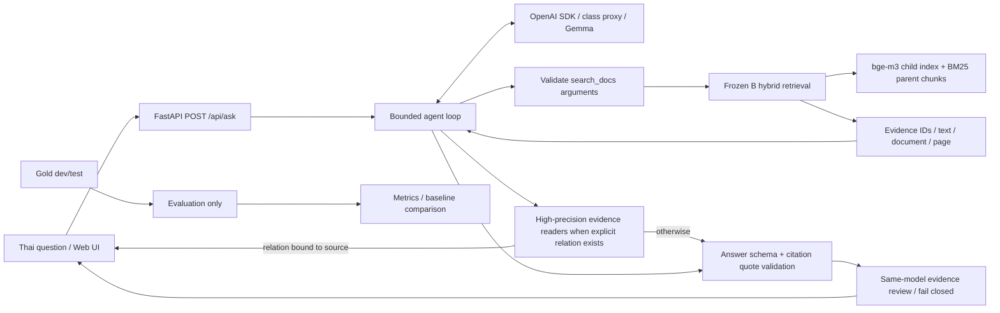

# NCD Evidence: Gemma ผ่าน class proxy

แอปถามตอบจากเอกสาร NCD ภาษาไทย ใช้ gold และ retrieval snapshot จาก Thai NCD Guideline QA แล้วต่อ `gemma-4-E4B-it` ผ่าน OpenAI SDK พร้อม native `search_docs` tool และ agent loop หน้าสาธิตแสดงคำตอบ ข้อความอ้างอิง เลขหน้า และ trace

โปรเจคนี้อยู่แยกจากต้นทางใน `D:\KMITL\LLMapp\ncd-gemma` ข้อมูลที่นำเข้าเป็นสำเนา ไม่มี runtime import หรือ write ไปที่ repository ต้นทาง

## เริ่มใช้งานบนเครื่องนี้

```powershell
cd D:\KMITL\LLMapp\ncd-gemma
.\run.ps1
```

เปิด `http://127.0.0.1:8765` การถามครั้งแรกจะโหลด bge-m3 และ index เข้า memory ครั้งต่อไปใช้ instance เดิม API รับคำถามครั้งละหนึ่งคำถามเพื่อจำกัดทรัพยากร การตรวจครั้งแรกบนเครื่องนี้ใช้เวลาโหลดประมาณ 298 วินาที และค้นหลักฐานจริงได้ 3 รายการ หากต้องการดูขั้นตอนโหลด ให้ตั้ง `$env:NCD_DEBUG_STARTUP='1'` ก่อนรัน

## ติดตั้งใน environment ใหม่

Environment ที่ทดสอบใช้ Python 3.12.13 และ CPU RAM เพียงพอสำหรับ bge-m3/index ไม่ต้องมี GPU

```powershell
py -3.12 -m venv .venv312
.venv312\Scripts\python -m pip install -r requirements-runtime.txt
Copy-Item .env.example .env
```

ตั้ง `OPENAI_API_KEY` และ `OPENAI_BASE_URL` เป็นค่าจาก class proxy ใน `.env` ไม่ส่ง key เข้า frontend และไม่ commit `.env` โมเดลถูกกำหนดเป็น `gemma-4-E4B-it` แอปตรวจ endpoint ว่าเป็น `https://llm.nat-d.uk` จึงไม่เผลอใช้ key กับบริการอื่น การอ่าน `.env` ของโปรเจคนี้จะ override ตัวแปรชื่อเดียวกันที่สืบทอดมาจาก shell

สำหรับ clean clone ให้ดึงชุดข้อมูล release ที่ตรึง hash ไว้ แล้วเตรียม model cache ที่ revision คงที่ (ใช้พื้นที่สำหรับ weights ประมาณ 6.4 GiB):

```powershell
.venv312\Scripts\python -B scripts/public_data.py fetch
$env:HF_HUB_OFFLINE = '0'
.venv312\Scripts\python -B scripts/prepare_models.py
$env:HF_HUB_OFFLINE = '1'
$env:PYTHONPATH = "$PWD\src"
.venv312\Scripts\python -B -m ncd_gemma.cli doctor --retrieval
.venv312\Scripts\python -B -m ncd_gemma.cli evaluate retrieval
```

`fetch` ดาวน์โหลด [data-v12 release](https://github.com/Up2mEz/LLM-APP-END2END/releases/tag/data-v12) และตรวจ SHA-256 ของ archive กับไฟล์ทั้ง 34 รายการตาม `provenance/public_data_release.json` ก่อนใช้ ชุดนี้มี corpus ที่ extract แล้ว, index, gold, frozen ranked hits และ table context; ไม่มี PDF ต้นฉบับ, model weights, API key หรือ private agent responses ผู้จัดทำยืนยันว่ามีสิทธิ์เผยแพร่และโฮสต์ข้อมูลชุดนี้แล้ว แต่เอกสารขอบเขตการอนุญาตไม่ได้แนบใน repository และ manifest สิทธิ์จากต้นทางยังเป็น snapshot เก่าที่ไม่ได้แก้

ตรวจเส้นทาง public จริงซ้ำได้ด้วย `.venv312\Scripts\python -B scripts/smoke_remote_release.py` สคริปต์จะ clone branch `main` ลง `tmp/`, ดาวน์โหลด release asset, ตรวจ hash และ replay frozen retrieval 6 runs ก่อนลบโฟลเดอร์ชั่วคราว ผลที่ตรวจ 12 ตุลาคม 2026: B−A Recall@5 `0.0769` และ MRR@10 `0.1193`

ทางเลือกสำหรับผู้มี source repository ในเครื่อง ใช้การ import แบบเดิม:

```powershell
python scripts/import_source.py --source "D:\KMITL\NLP\NLP-Year3\team-project\thai-ncd-guideline-qa"
```

สำหรับ context ตารางรุ่นปัจจุบัน ติดตั้ง dev dependencies แล้วรันตัวสร้างตารางหนึ่งครั้ง โดยอ่าน PDF ต้นทางอย่างเดียว:

```powershell
.venv312\Scripts\python -B scripts/build_table_context.py --source "D:\KMITL\NLP\NLP-Year3\team-project\thai-ncd-guideline-qa"
.venv312\Scripts\python -B scripts/verify_table_sources.py
```

Derived table artifact อยู่ใต้ data/table_context และถูก ignore; serving ไม่อ่าน repo ต้นทาง แผน dev ล็อก table hash เพิ่มด้วย

สคริปต์อ่าน allow-list 48 ไฟล์ ตรวจ SHA-256 ก่อนและหลัง copy และปฏิเสธการเขียนทับไฟล์ปลายทางที่เปลี่ยนไป ข้อมูลอยู่ใต้ `data/` ซึ่ง Git ignore ไว้ทั้งหมด ไม่มี secret ถูกคัดลอกด้วยสคริปต์นี้ ดูรายการต้นทางและ hashes ใน `provenance/source_snapshot.json`

ต้องมี Hugging Face cache ของ [`BAAI/bge-m3`](https://huggingface.co/BAAI/bge-m3) revision `5617a9f61b028005a4858fdac845db406aefb181` และ `refs/main` ของ cache ต้องตรง revision นี้ แอปตั้ง offline mode โดย default เพื่อไม่เปลี่ยน weights ระหว่างรัน การเปลี่ยน answer LLM ไม่ต้องสร้าง document vectors ใหม่ รุ่นปัจจุบันต้องมี cache ของ [`BAAI/bge-reranker-v2-m3`](https://huggingface.co/BAAI/bge-reranker-v2-m3) revision `953dc6f6f85a1b2dbfca4c34a2796e7dde08d41e` เพิ่มสำหรับเรียง short passages; ใช้ offline CPU และไม่สร้าง index ใหม่

## การนำไปโฮสต์

`Dockerfile` ใช้ Python 3.12, PyTorch CPU-only, model revisions และ data release เดียวกับคำสั่งข้างบน ต้องตั้ง runtime secrets `OPENAI_API_KEY` และ `OPENAI_BASE_URL=https://llm.nat-d.uk/v1`; ตั้ง `NCD_PUBLIC_HOST` เป็น hostname จริงแบบไม่มี `https://` และตั้ง `NCD_DEMO_PASSWORD` ยาวอย่างน้อย 12 ตัวอักษร (`NCD_DEMO_USER` มีค่าเริ่มต้น `demo`) ระบบจะใช้ HTTP Basic Auth กับหน้าเว็บและ API ทุก route ยกเว้น health check จึงต้องเปิดผ่าน HTTPS เท่านั้น ส่ง username/password ให้ผู้ตรวจแยกจาก repository และอย่า commit secrets

ตัวอย่างการสร้าง image และรันบน host ที่มี RAM/พื้นที่พอ:

```sh
docker build -t ncd-gemma:release .
docker run --rm -p 7860:7860 --env-file .env.production ncd-gemma:release
```

ไฟล์ `.env.production` ต้องเก็บใน host และไม่ commit โปรเจคนี้ยังไม่ได้ยืนยันว่า Docker image build และแอปรันบน Linux host สำเร็จ จนกว่าจะมี Docker engine หรือ host ให้ทดสอบจริง

## คำสั่งตรวจและประเมินผล

```powershell
$env:PYTHONPATH = "$PWD\src"
.venv312\Scripts\python -B -m ncd_gemma.cli doctor
.venv312\Scripts\python -B -m ncd_gemma.cli doctor --retrieval
.venv312\Scripts\python -B -m ncd_gemma.cli doctor --live
.venv312\Scripts\python -B -m pytest -q
.venv312\Scripts\python -B -m ncd_gemma.cli evaluate retrieval
.venv312\Scripts\python -B -m ncd_gemma.cli evaluate plan
.venv312\Scripts\python -B -m ncd_gemma.cli evaluate agent
```

`doctor --live` และ `evaluate agent` เรียก class proxy จริง `evaluate retrieval` คำนวณ metrics จาก saved ranked hits และตรวจ hash ไม่เรียกโมเดลหรือรัน test retrieval ใหม่ `evaluate plan` ล็อก dev sample 30 ข้อก่อนเรียกโมเดล แผนผูกกับ hashes ของ agent, verifier, adapter, schemas, config และ retrieval wrapper การเปลี่ยน implementation คำถามหรือ prompt หลังมีแผนต้องสร้าง version ใหม่ ไม่ปรับแผนตามผล

ผล aggregate อยู่ใน `reports/` ผลคำตอบพร้อมหลักฐานอยู่ใน `private/runs/` และ raw model cache อยู่ใน `.cache/llm/` ทั้งสองโฟลเดอร์ถูก ignore การรัน agent evaluation ซ้ำ resume จาก qid ที่มีอยู่แล้ว ไม่เรียก API ซ้ำโดยไม่จำเป็น Cache เก็บ response เต็มรวม tool calls และผูกกับ endpoint identity, model, messages, tools และ parameters

## โครงสร้าง

```text
src/ncd_gemma/     app, SDK adapter, validation, agent loop, evaluation
src/ncdqa/        สำเนา retrieval modules จากโปรเจคเดิม
configs/          frozen retrieval configuration
static/           หน้าเว็บภาษาไทย ไม่มี external scripts/fonts
schemas/          question/retrieval schemas จากต้นทาง
scripts/          import และเครื่องมือทำเอกสาร
tests/            protocol, citation, failure และ API tests
data/             corpus/index/gold/frozen runs (private, ignored)
reports/          aggregate metrics และเอกสารผลทดสอบ
private/          คำตอบจริงและ evidence (ignored)
provenance/       hashes และ attribution
```

## Architecture และขอบเขต tool



Gold ไม่ถูกโหลดโดย serving layer และไม่มี reference answers ถูกส่งให้ Gemma ฝั่ง retrieval ใช้ child 128 tokens, parent 512 tokens, bge-m3, BM25 char3, k1=2.18, b=0.86 และ min-max convex fusion alpha=0.6, pool=100 ตาม frozen config เดิม

Agent บังคับเริ่มด้วย `search_docs` จากนั้นเลือกค้นเพิ่มหรือตอบได้เอง เก็บ assistant tool calls และส่ง tool result กลับพร้อม `tool_call_id` ที่ตรงกัน configuration ที่ทดสอบจำกัด 6 model rounds รวม verification, 3 searches, top_k ไม่เกิน 8 และ context รวม 18,000 ตัวอักษร ปฏิเสธ query/filter ซ้ำ ชื่อ tool อื่น และ filter ที่ไม่มีใน metadata รอบสุดท้ายปิดการเรียก tools มี request timeout และ agent deadline

คำถามทักทายล้วนตอบเป็น `out_of_scope` ทันทีโดยไม่โหลด retrieval หรือเรียก proxy คำถาม NCD ยังเริ่มด้วย native `search_docs` ผลค้นบางแบบมีความสัมพันธ์ตรงและตรวจรูปแบบได้ เช่น ชื่อหัวข้อฉลาก รอบ CQI + PDCA เป้าความดันตามเงื่อนไข และคำถามข้ามสองเอกสาร DASH/ไต จึงใช้ evidence-bound route ที่อ่านค่าจากข้อความจริงพร้อม citation ถ้า route ไม่ผ่านจึงใช้ Gemma สร้างคำตอบและ reviewer ตามเดิม ทุก citation ต้องอ้าง source ID จาก tool, quote ต้องอยู่ในข้อความที่ค้นได้ และ marker ต้องตรงกัน การตรวจ quote ไม่ได้พิสูจน์ความหมายทุกประโยค

## ผล retrieval และ baseline

ผลจาก saved frozen test มี 56 gold questions เป็น answerable 52 และ unanswerable 4 ข้อ ค่าเฉลี่ยต่อไปนี้ใช้ 52 ข้อที่ตอบได้

| ระบบ | Strict Recall@5 | Strict MRR@10 |
|---|---:|---:|
| A dense parent-child (baseline) | 0.8077 | 0.6181 |
| B hybrid parent-child (แอปเลือกใช้) | 0.8846 | 0.7374 |
| C hybrid + reranker (ผลทดลองเดิม) | 0.9135 | 0.7706 |

B เพิ่ม Recall@5 7.69 percentage points และ MRR@10 0.1193 เมื่อเทียบ A แอปไม่ใช้ variant C ของ frozen run; ใช้ reranker รุ่นเดียวกันกับ short passages ที่โฟกัสคำถาม ซึ่งเป็น pipeline คนละแบบและยังไม่อ้าง frozen C metrics เป็นผลของแอป ผลตารางนี้เป็น retrieval quality เดิม ไม่ใช่ answer accuracy หรือผลของ agent ที่เปลี่ยน query เอง

ชุดข้อมูลมี 177 แถว ใช้ gold 162 ข้อ (dev 106/test 56) และตัด rejected 15 ข้อ ผล agent evaluation ใช้ dev sample ที่ล็อก 30 ข้อ เป็น development result แยกจาก frozen test มี abstention decision accuracy, citation primary-evidence coverage และ character F1 โดย character F1 เป็นเพียง text overlap ไม่ใช่ความถูกต้องทางคลินิก ดูผลรันจริงและข้อจำกัดใน `reports/gemma_dev_metrics.json` เมื่อ evaluation เสร็จ

## สิ่งที่ตรงกับโจทย์ Project

| Capability | Implementation |
|---|---|
| 1 Structured output | Pydantic answer/tool schemas + bounded repair |
| 2 Retrieval/RAG | Frozen hybrid retrieval + evidence/citations |
| 3 Retrieval evaluation | Gold labels + reproducible saved-hit metrics + A/B baseline |
| 4 Agentic tool calling | Gemma native search_docs loop + stop conditions |
| 6 Served interface | FastAPI REST API + Thai browser UI |

มี incremental Git commits สำหรับงานนี้ อ่าน proposal และ demo script ใน `docs/` และรายงานผลจริงใน `reports/` repository ปลายทางคือ [Up2mEz/LLM-APP-END2END](https://github.com/Up2mEz/LLM-APP-END2END) ดูสถานะที่ตรวจล่าสุดใน `docs/SUBMISSION_AUDIT_2026-10-12_TH.md` และตรวจ Q2 PDF/demo URL แยกจากความสำเร็จของ local tests

## สถานะการตรวจล่าสุด 12 ตุลาคม 2026

v30 ตรวจสาระครบ **25/25** ใน 25 ข้อที่ gold ระบุว่าตอบได้จาก dev 30 ข้อเดิม เทียบ v24 **21/25** เพิ่ม 4 ข้อ และงดตรง label อีก 5 ข้อ v27 เคยถอยเป็น 24/25 เพราะ q108 อธิบายอาหารกระป๋องไม่ครบ แล้ว v28 แก้กลับ v29–v30 ไม่เปลี่ยนคำตอบชุดนี้ ผลทั้งหมดเป็น exposed dev ที่ใช้ปรับระบบ ไม่ใช่หลักฐานว่าจะตอบคำถามใหม่ถูกทั้งหมด ภายหลังเพิ่ม retry ของ class proxy เมื่อ connection หลุด 1 ครั้ง โดยยังไม่ได้รัน dev evaluation ซ้ำกับ adapter ที่เปลี่ยนนี้

| Dev 30 ชุดเดิม | v13 | v24 | v26 | v27 | v28–v30 |
|---|---:|---:|---:|---:|---:|
| สาระครบจากการตรวจ | 14 | 21 | 25 | 24 | 25 |
| ตอบแล้วผิด/ไม่ครบ/ต้องทบทวน | 9 | 2 | 0 | 1 | 0 |
| False abstention | 2 | 2 | 0 | 0 | 0 |
| ตอบ / งดตอบ | 23 / 7 | 23 / 7 | 25 / 5 | 25 / 5 | 25 / 5 |
| Abstention decision accuracy | 0.9333 | 0.9333 | 1.0000 | 1.0000 | 1.0000 |
| Citation primary-evidence hit rate | 0.5600 | 0.6000 | 0.6400 | 0.7200 | 0.7200 |
| Character F1 | 0.2805 | 0.3464 | 0.4217 | 0.4265 | 0.4453 |

- Tests **170 passed**, 0 failed/error/skipped; Starlette deprecation warning 1 รายการ (ตรวจซ้ำหลังเพิ่ม bounded connection retry)
- ตรวจ SHA-256 ของ source allow-list 48 ไฟล์และ PDF ที่อ่าน 33 ไฟล์ไม่เปลี่ยน gold เดิมไม่แก้
- v25 เพิ่ม high-precision evidence-bound routes โดยไม่ใช้ qid/เฉลยใน serving: q061 ชื่อ field ฉลาก, q115 รอบ+วงจร, q111 ความสัมพันธ์ DASH/CKD และ q106 ค่าเฉพาะเงื่อนไข

- v26 ทดสอบคำถามสังเคราะห์ที่ทำให้ v25 ตอบผิด: โปรตีนจากอาหารไม่ใช่ proteinuria และผู้ล้างไตแล้วไม่ใช่ผู้ป่วยก่อนล้างไต จึงเพิ่ม guard ของบริบท ตรวจปีจาก document edition ตรวจ 4 ส่วนก่อนตอบ 1 ใน 4 และคงตัวเปรียบเทียบของค่าตามหลักฐาน ผล dev 30 ชุดเดิมเหมือน v25 ทุกข้อ ยกเว้น q111 ที่เติมเงื่อนไข “หากไม่อิ่ม” ให้ตรงต้นฉบับ
- Extra-dev 30 ข้อที่ไม่ซ้ำชุดแรกใน v26 ตรวจคำตอบกับ gold และ citation ทีละข้อ: **ถูกหรืองดถูก 19/30**; 6 ข้องดเกินจำเป็น, 2 ข้อตอบผิด, 2 ข้อตอบทั้งที่หลักฐานไม่รองรับ และ 1 ข้อไม่ครบ หลังใช้ผลแก้ระบบ v28 ได้ 27/30 (ยังงดเกินจำเป็น q006/q107/q110) และ v29–v30 ได้ 30/30 (26 ตอบถูก, 4 งดตรง label) ชุดนี้เปิดผลแล้ว ผลรันซ้ำจึงเป็น regression ไม่ใช่ unseen evaluation หรือ clinical accuracy
- v27–v28 เพิ่มการดึงแถวตาราง HTML/บริบทข้างเคียง, lexical admission ของข้อความน้ำหนัก–ส่วนสูง, ซ่อม citation จาก quote ที่ตรง source, prune claim ที่ไม่ตรง, ตรวจขอบเขตยา/กลุ่มผู้ป่วย และตรวจคำตอบเปรียบเทียบสองฝั่ง q108 แก้ด้วย evidence reader ที่ต้องมีทั้งสาเหตุจากอาหารกระป๋องและโซเดียมใน MSG
- v29 เพิ่ม evidence readers ที่อ่านแถว Infection ของ secondary MCD, คู่เปรียบเทียบ conventional intermittent hemodialysis กับ SLED จาก edition เดียว และปริมาณข้าวขาว/โคล่าที่ผูกหน่วยกับค่าจริง จึงเปลี่ยน q006/q107/q110 จากงดเป็นตอบครบ v30 เพิ่ม negative-question guards ป้องกันการนำคำตอบนี้ไปใช้กับ primary MCD, ระบบไหลเวียนไม่คงที่ หรือคำถามปฏิเสธปริมาณคาร์บ; synthetic tests และการ replay ของหลักฐานจริงผ่าน
- คำทักทายอย่าง `hello` แยกจากคำถาม NCD และตอบทันทีโดยไม่ค้น/เรียกโมเดล
- ตาราง q113/q079/q080 ยังได้ค่าถูก; q078 กลับมามีทั้งขนาดยาและความถี่
- v25 บันทึก 48 HTTP attempts ใหม่และใช้ cache เมื่อ payload ตรง; route ทั้งสี่ใช้ cached tool call ในรันนี้ จึงไม่ใช่ independent repeat generation

- v26 บันทึก 0 HTTP attempts ใหม่เพราะ payload ของ 30 ข้อเดิมตรง cache; เป็น regression run ไม่ใช่การสุ่มคำตอบใหม่หรือ held-out test
- v28 บน dev 30 ข้อเดิมบันทึก 0 HTTP attempts ใหม่เช่นกัน; คำตอบเปลี่ยนจาก v27 เฉพาะ q108 และตรวจสาระครบ 25/25 อีกครั้ง
- v30 บน dev 30 และ extra-dev 30 บันทึก 0 HTTP attempts ใหม่เพราะ payload ตรง cache; คำตอบ/สถานะ/citation ทั้ง 60 ข้อตรงกับ v29 ทุกข้อ การตรวจ 30/30 ของ extra-dev อาศัย semantic audit ที่ทำหลัง v29 ไม่ใช่ผู้ตรวจอิสระหรือ generation ใหม่

ผลเป็นการพัฒนาบน exposed dev ที่ตรวจโดย coding agent ไม่ใช่ independent expert validation. คะแนนเลือกตอบ/งดและ Character F1 ไม่ใช่ clinical accuracy ยังต้องทดสอบคำถามใหม่และอ่านโดยผู้เชี่ยวชาญก่อนอ้าง generalization เก็บผลทุกรุ่นรวมรอบที่แย่ลงไว้ใน reports/history และ private/runs

อ่าน [ผลรายข้อ dev](docs/DEV_COMPARISON_TH.md), [ผล extra-dev v26](docs/EXTRA_DEV_V26_REVIEW_TH.md), [เทคนิคทั้งหมดและ workflow](docs/WORKFLOW_AND_REUSE_TH.md), [สถานะตาม rubric](docs/PROJECT_READINESS_TH.md), [ตรวจความพร้อมส่ง 12 ต.ค.](docs/SUBMISSION_AUDIT_2026-10-12_TH.md) และ [ผล UI](docs/UI_REVIEW_TH.md)

## ข้อสังเกตจาก class proxy

Proxy ส่ง Gemma native syntax อยู่ใน `function.arguments` บางครั้ง จึง parse รูปแบบที่อนุญาตด้วย parser ที่ไม่ใช้ eval แล้วส่งกลับเป็น JSON ที่ผ่าน schema ก่อนทำ tool call รอบถัดไป Raw response ยังอยู่ใน cache

รอบตรวจคำตอบแยกใช้ Gemma ตัวเดิมเปรียบเทียบ question/answer/evidence โดยไม่รับ gold label ผู้ตรวจแยกประเด็นและเลือกเลขบรรทัดอ้างอิง ระบบคัดข้อความให้เอง หากรูปแบบหรือ quote ไม่ผ่านซ่อมได้หนึ่งครั้งภายใน budget เดิม ต้องละ `tools` และ `tool_choice` เมื่อไม่ใช้ tools เพราะ proxy ปฏิเสธ empty tools + tool_choice คำตอบที่ตรวจไม่ได้จะงดตอบ รอบตรวจนี้นับรวมใน budget 6 model rounds และ 150 วินาที (HTTP 429 retry แยกนับ attempts) ไม่ใช่ independent verifier และยังปล่อยคำตอบผิดบางข้อ

แหล่ง protocol: [Google Gemma 4 function calling](https://ai.google.dev/gemma/docs/capabilities/text/function-calling-gemma4) พฤติกรรม HTTP 400 ข้างต้นตรวจพบจาก class proxy จริง ไม่ได้อนุมานว่าใช้ server implementation ใด

## การเผยแพร่และข้อจำกัด

ต้นทางเป็น private repository และ handoff ระบุว่าบาง corpus text ใช้ภายในทีมเท่านั้น จึงไม่ได้ commit gold, chunks, index, raw answers หรือ source PDFs การมี import script จาก local private artifacts ยังไม่ทำให้ผู้ตรวจที่ไม่มีสิทธิ์เข้าถึงข้อมูล reproduce ได้จาก public GitHub เพียงอย่างเดียว **Q1 เรื่อง public reproducibility ยังต้องจัดการสิทธิ์หรือเลือก corpus ที่เผยแพร่ได้ก่อนส่ง** ถ้าเปลี่ยน corpus ต้อง version และประเมินชุดใหม่ ไม่คัดตัวเลข v12 ไปอ้างกับ subset

แอปนี้เป็นเครื่องมืออ่านเอกสาร ไม่ใช้วินิจฉัยรายบุคคล Gold เดิมตรวจความตรงกับเอกสาร ไม่ใช่การรับรองทางคลินิก Retrieval score ไม่ใช่ confidence ในคำตอบ ข้อจำกัดที่ต้องดูในการประเมินคือข้อมูลนอกขอบเขต เงื่อนไขเฉพาะกลุ่ม ตัวเลขจากตาราง และ citation ที่มี quote จริงแต่ไม่สนับสนุนคำตอบทั้งหมด

## Attribution และเอกสารอ้างอิง

- [Thai NCD Guideline QA](https://github.com/Chaiporn2005/thai-ncd-guideline-qa): retrieval modules, gold, artifacts และผล frozen ของทีม อ้าง snapshot ที่บันทึกไว้ใน provenance ไม่อ้างว่าเริ่มสร้างส่วนนี้ใหม่ในวิชา LLM
- [โจทย์ Project](https://courses.nat-d.uk/courses/building-llm-powered-applications/courseworks/20): class proxy/model, capability families, baseline, report 4–8 หน้า และ demo 3–6 นาที
- [OpenAI Docs: Function calling](https://developers.openai.com/api/docs/guides/function-calling): รูปแบบ assistant tool calls และ tool results ที่ใช้ tool_call_id
