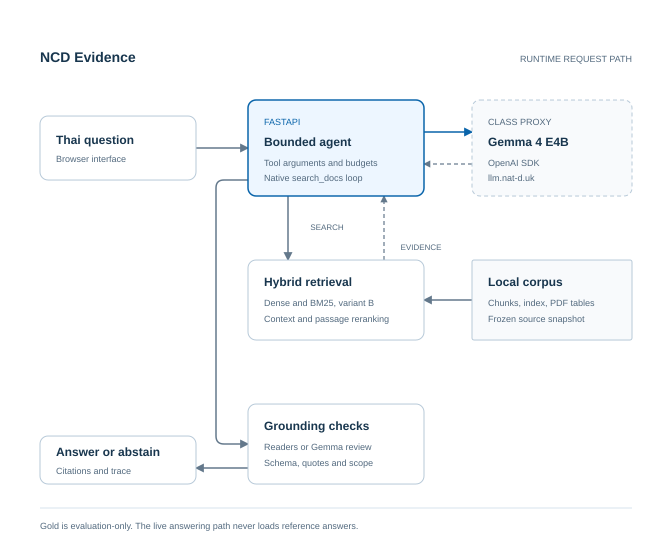

# NCD Evidence

ระบบถามตอบจากหลักฐานในเอกสาร NCD ภาษาไทย

รายงานโครงงานรายวิชา Building LLM-Powered Applications

ผู้จัดทำ นายธนกฤต เสมอหน้า รหัสนักศึกษา 67070060

ผู้สอน ดร. ณัฏฐ์ ดิลกธนากุล

### บทคัดย่อ

โครงงานนี้พัฒนาแอปถามตอบจากเอกสารโรคไม่ติดต่อเรื้อรังภาษาไทย ผู้ใช้ถามด้วยภาษาธรรมชาติและเปิดดูเอกสาร ฉบับพิมพ์ หน้า และข้อความที่ใช้ตอบได้ ระบบใช้ Gemma ผ่าน class proxy ร่วมกับ retrieval, native tool calling และการตรวจ structured output เพื่อจำกัดคำตอบให้อ้างอิงหลักฐานที่ค้นพบ

ประเมิน pipeline ปัจจุบันใหม่ในชุด capstone-current-v2 ด้วย gold dev 30 ข้อ เทียบ dense baseline กับ hybrid โดยคงส่วนอื่นเหมือนกัน Strict Recall@5 บนข้อที่ตอบได้ 25 ข้อเท่ากับ 0.8200 และ 0.9000 ตามลำดับ การตรวจคำตอบแบบซ่อนชื่อแขนด้วย GPT-6-Luna xhigh ให้ semantic success 23/30 และ 28/30 ผลนี้เป็นการประเมินบนข้อมูลที่เคยใช้พัฒนาและมีความคลาดเคลื่อนจาก LLM-as-judge จึงไม่ใช้ยืนยันความถูกต้องทางคลินิก

### 1. ปัญหา ผู้ใช้ และวัตถุประสงค์

แนวทาง NCD มีหลายฉบับ หลายกลุ่มประชากร และตารางที่ต้องอ่านร่วมกับหัวคอลัมน์ การค้นพบคำตรงกันอาจนำไปสู่คำตอบผิดบริบท แอปช่วยนักศึกษาและผู้ที่อ่านเอกสารลดเวลาค้น พร้อมตรวจที่มาของคำตอบได้ วัตถุประสงค์คือสร้างระบบครบเส้นทางจากคำถามถึงหลักฐานและวัดคุณภาพเทียบ baseline ขอบเขตคือการช่วยอ่านเอกสาร ไม่รวมการวินิจฉัยหรือจัดแผนรักษาเฉพาะบุคคล

## 2. สถาปัตยกรรมและการออกแบบ

React รับคำถามและส่งผ่าน FastAPI ไปยัง Agent ซึ่งใช้ from openai import OpenAI เรียก gemma-4-E4B-it ผ่าน class proxy อ่าน OPENAI_API_KEY และ OPENAI_BASE_URL จาก environment คำถามในขอบเขตเริ่มด้วย native search_docs โค้ดตรวจชื่อ tool และ SearchArgs ก่อนเรียก retrieval และคืนผลพร้อม tool_call_id ที่ตรงกัน

Agent ใช้หลักฐานที่ค้นได้สร้างคำตอบแบบมี schema พร้อม citations จากนั้นตรวจ source IDs, quote และเงื่อนไขที่เกี่ยวข้อง บางคำถามใช้ source-bound reader อ่านค่าที่ตรวจตรงหลักฐานได้ กรณีอื่นให้ Gemma เสนอและตรวจคำตอบ หาก schema หรือหลักฐานไม่ผ่านจะซ่อมภายใน budget หรืองดตอบ ไม่ส่ง gold answer เข้าเส้นทางให้บริการ

กำหนด temperature=0, ไม่เกิน 6 model rounds และ 3 searches, request timeout 45 วินาที เวลารวม 150 วินาที และ context 18,000 ตัวอักษร หยุดเมื่อคำตอบผ่าน หลักฐานไม่พอ หรือถึงขีดจำกัด ไม่มี tool สำหรับ shell หรือการอ่านไฟล์ตามคำสั่งโมเดล

## 3. ข้อมูลและเทคนิคที่ใช้

Corpus ใช้ snapshot normalized-v12 ที่มี 66 เอกสาร Child chunks 23,819 ชิ้น Parent chunks 4,347 ชิ้น และ dense vectors 1,024 มิติ Gold มี 162 ข้อ (dev 106 และ test 56) จากทั้งหมด 177 แถว ส่วน rejected 15 ข้อไม่นำมาประเมิน ข้อมูลและโมดูล retrieval ที่นำมาใช้มี provenance และ hashes ใน repository

ผู้จัดทำให้ coding agent ร่างคำถามและคำตอบ จากนั้นตรวจ gold ร่วมกับเพื่อน ผู้จัดทำตรวจ dev ทั้งหมดเอง และแบ่งตรวจ test กับเพื่อนเท่า ๆ กัน การตรวจ gold นี้แยกจากการให้ LLM-as-judge ตรวจคำตอบแอปในรอบปัจจุบัน

Dense search ใช้ bge-m3 ส่วน hybrid รวม dense กับ BM25 char3 ผ่าน min-max normalization และ convex fusion alpha=0.6 ใช้ candidate pool 100 ค่าตั้งต้นสืบทอดจาก retrieval configuration แอปเพิ่ม passage focus, ข้อความข้างเคียง, table context และ bge-reranker-v2-m3 ก่อนส่งหลักฐานให้ Agent

| Capability family | การใช้งานและเหตุผล |
| --- | --- |
| 1 Structured output | Pydantic ตรวจชนิดข้อมูลและ citations เพื่อให้ API รับผลที่มีรูปแบบแน่นอน |
| 2 Retrieval / RAG | ค้นเอกสารก่อนตอบและแสดง quote ให้ผู้ใช้ตรวจที่มา |
| 3 Retrieval evaluation | วัด Recall@5, Hit@5 และ MRR@5 บน gold พร้อม baseline |
| 4 Agent loop | โมเดลเรียก search_docs ภายใต้ allow-list และ stop conditions |
| 6 Served interface | FastAPI เชื่อมหน้าเว็บ React สำหรับถามและตรวจหลักฐาน |

ทั้งห้าครอบคลุม evaluation และ agentic family ตามโจทย์ ไม่จำเป็นต้องเพิ่มทุกเทคนิคในรายวิชา

## 4. วิธีประเมิน pipeline ปัจจุบัน

ล็อกชุด capstone-current-v2 และ hash ของโค้ด ข้อมูล คำถาม และ configuration ก่อนรัน คัด dev 30 ข้อด้วย SHA-256 ตามกฎที่บันทึกไว้ มี condition, fact, multi_page, number_unit, table และ unanswerable อย่างละ 5 ข้อ เป็น answerable 25 ข้อและ unanswerable 5 ข้อ ชุดนี้เป็น exposed dev ไม่ใช่ held-out

Baseline ใช้ variant A (dense) ส่วนระบบปัจจุบันใช้ variant B (hybrid) ทั้งคู่คง passage focus, table context, reranker ON, prompt, model และ agent budget เหมือนกัน จึงวัดผลของวิธีค้นขั้นต้น และไม่เรียก baseline นี้ว่า no-RAG หรือ dense ล้วน

Retrieval stage เรียก retriever จริงใหม่ด้วยคำถามเต็ม top_k=5 ทั้ง 60 รายการ ไม่อ่าน saved ranked hits คะแนน strict relevance ตรวจ edition หน้า และ quote coverage ของ passage ที่คืนจริง Recall@5 เป็นค่าเฉลี่ยสัดส่วน gold evidence ที่พบต่อข้อ Hit@5 วัดว่ามีหลักฐานตรงอย่างน้อยหนึ่งรายการ และ MRR@5 วัดส่วนกลับอันดับแรกที่เกี่ยวข้อง ใช้ตัวหาร 25 ข้อที่ตอบได้

Answer stage ส่ง 30 ข้อ × 2 แขนผ่าน /api/ask ของ FastAPI instance สำหรับ eval ใช้ Agent, ProxyClient และ EvidenceRetriever ตัวเดียวกับแอป เปิด use_cache=false ทุกคำขอ มี pilot 2 requests ซึ่งไม่รวมคะแนน จำกัดรอบทั้งหมด 62 app requests และ 744 proxy attempts เก็บ service errors ไว้ในผลและหยุดเมื่อเกิดติดกันสามครั้ง

GPT-6-Luna reasoningEffort=xhigh ตรวจ packet ที่ซ่อนชื่อแขน โดยเห็นคำถาม gold หลักฐาน และคำตอบพร้อม citations ให้คะแนนสำเร็จเฉพาะ correct หรือ correct_abstention ทุก verdict รวม uncertain และ service_error อยู่ในตัวหาร 30 ต่อแขน T3 transport ไม่เปิดการตั้ง temperature ของ judge จึงไม่อ้างว่า judge ใช้ 0 ส่วน Gemma ที่ตอบใช้ 0 ทุกข้อ

## 5. ผลการทดลองและการแปลผล

ตารางที่ 1 ผล retrieval ใหม่บน answerable dev 25 ข้อ

| ระบบ | Strict Recall@5 | Hit@5 | MRR@5 |
| --- | --- | --- | --- |
| Dense baseline | 0.8200 | 0.8400 | 0.7047 |
| Hybrid current | 0.9000 | 0.9200 | 0.7833 |

ผลรอบนี้สนับสนุนการเลือก hybrid เพราะเพิ่ม Recall@5 0.0800 เมื่อคงส่วนอื่นเหมือนกัน การวัดนี้ใช้คำถามเต็มค้นครั้งเดียวต่อข้อ ส่วน Agent อาจเปลี่ยน query ระหว่างตอบ จึงแยกผล retrieval จากผลคำตอบตลอดเส้นทาง

ตารางที่ 2 ผลคำตอบบน dev 30 ข้อ รวมการงดตอบและบริการขัดข้อง

| ระบบ | สำเร็จตาม judge | Semantic success | Decision accuracy | Service errors |
| --- | --- | --- | --- | --- |
| Dense baseline | 23/30 | 0.7667 | 0.8333 | 1 |
| Hybrid current | 28/30 | 0.9333 | 0.9333 | 2 |

Semantic success ต้องตอบสาระที่ถามครบและหลักฐานรองรับ หรือเป็นการงดตอบที่ถูกต้อง ส่วน decision accuracy วัดเพียงการเลือกตอบหรืองด จึงอาจได้คะแนนดีแม้เนื้อหาผิด Primary citation hit เท่ากับ 0.6400 และ 0.6400 ตามลำดับ ใช้ตัวหาร 25 ข้อและตรวจหลักฐานที่ถูกอ้าง ไม่ได้ยืนยันความครบของคำตอบทั้งหมด

ค่ามัธยฐานเวลาต่อคำถามในเครื่องนี้คือ dense 20.9 วินาที และ hybrid 20.9 วินาที เวลารวม retrieval, model และ verification หลังโหลดโมเดลแล้ว ผลขึ้นกับฮาร์ดแวร์ บริการ และลำดับคำถาม จึงใช้บอกประสบการณ์ของรอบนี้และไม่อ้างเป็น benchmark ข้ามเครื่อง

การทดลองแยกเปิด/ปิด reranker บน hybrid และคำถามชุดเดียวกันให้ Recall@5 0.9000 / 0.7400 เวลามัธยฐานเฉพาะ retrieval 14.49 / 0.23 วินาที การปิดช่วยลดเวลาค้นแต่พบหลักฐานน้อยลง ผลนี้รองรับการให้ผู้ใช้เลือกโหมด แต่ไม่ได้วัดคุณภาพคำตอบ end-to-end เมื่อปิด reranker

## 6. กรณีผิดพลาดและการวิเคราะห์

### q101 (hybrid_current): service_error

คำถาม: ในระบบติดตามนัด NCD หากผู้ป่วยเดินทางมาเองไม่ได้ เจ้าหน้าที่ช่วยจัดการอย่างไร

ผลตรวจ: Class proxy ส่ง HTTP 429 จึงไม่ได้คำตอบสมบูรณ์จากระบบ กรณีนี้เป็นความผิดพลาดของบริการและยังนับอยู่ในตัวหาร

ระบบหยุดด้วย proxy_http_429 หลักฐานการตัดสิน:

### q082 (dense_default): false_abstention

คำถาม: เกณฑ์สารอาหารวัยรุ่นที่อ้างอิงปี 2546 ให้เด็กหญิงอายุ 13–15 ปีได้โปรตีนวันละเท่าไร

ผลตรวจ: งดตอบทั้งที่ตารางระบุโปรตีนสำหรับเด็กหญิงอายุ 13–15 ปีไว้ชัดเจนที่ 55 กรัมต่อวัน

ระบบหยุดด้วย completed หลักฐานการตัดสิน: S3, ตาราง PDF หน้า 55: โปรตีน (กรัม), อายุ 13–15 ปี, หญิง = 55

### q113 (dense_default): partial

คำถาม: ทารกวัย 6–8 เดือนควรได้พลังงานและโปรตีนจากอาหารตามวัยวันละเท่าไร

ผลตรวจ: The answer gives the supported 219 kcal/day from complementary food for ages 6-8 months, but omits the requested protein amount.

ระบบหยุดด้วย completed หลักฐานการตัดสิน: S1, p. 25: Paraphrase: the 6-8 month row assigns 219 kcal/day to complementary food.

ตารางที่ 3 การแจกแจง verdict จาก LLM-as-judge

| Verdict | Dense | Hybrid |
| --- | --- | --- |
| correct | 19 | 23 |
| partial | 1 | 0 |
| wrong | 1 | 0 |
| unsupported | 0 | 0 |
| correct_abstention | 4 | 5 |
| false_abstention | 4 | 0 |
| service_error | 1 | 2 |
| uncertain | 0 | 0 |

รอบนี้พบ class proxy ตอบ HTTP 429 จำนวน 3 รายการ (dense 1 และ hybrid 2) เก็บเป็น service errors และไม่เรียกซ้ำแทนผลเดิม การให้คะแนนยังป้องกัน verification_unavailable ถูกนับเป็น correct_abstention แม้ API ส่ง status ว่า insufficient_evidence คำตอบที่ตรวจไม่ได้ใช้ uncertain และอยู่ในตัวหาร การให้ judge เป็นโมเดลยังอาจอ่านเงื่อนไขหรือหลักฐานผิด ต้องอ่านเหตุผลรายข้อประกอบคะแนน

## 7. การทำซ้ำและการตรวจสอบหลักฐาน

README ระบุการสร้าง Python environment ตั้งค่า class proxy ดาวน์โหลดข้อมูลด้วย scripts/public_data.py fetch เตรียมโมเดล และ build frontend ก่อนใช้ run.ps1 ไม่มี API key ใน manifest หรือรายงาน หลักฐานรอบนี้อยู่ที่ reports/capstone-current-v2/ ส่วน raw และ trace อยู่ใน private/capstone-current-v2/ สำหรับการตรวจในเครื่อง

คำสั่ง python -m ncd_gemma.capstone_eval verify --run capstone-current-v2 ตรวจ hash โดยไม่เรียกโมเดล จากนั้น run ใช้ pipeline จริงและ summarize คำนวณผลจาก raw ที่ครบสองแขน คำสั่ง plan ปฏิเสธเขียนทับ manifest เดิม การ resume ข้ามเฉพาะคำขอที่มีผลบันทึกครบ หากมีคำขอค้างไม่ทราบผลจะหยุดแทนการยิงซ้ำโดยอัตโนมัติ

ชุดทดสอบ harness ตรวจการสลับ variant โดยคง options, การแยก pilot, การปฏิเสธข้อมูลซ้ำหรือผิด run, การหยุดเมื่อ outage และการเก็บ errors ในตัวหาร มี regression test สำหรับ verification failure และการขัดข้องระหว่างบันทึก budget กับผลตอบ การทดสอบโค้ดใช้ fixture ส่วนผลในตารางมาจากการเรียกจริง

Judge packet และ rubric มี hash แยก เก็บ verdict รายข้อพร้อมเหตุผลและ source references Collector ตรวจจำนวนและ item IDs ก่อนคำนวณคะแนน ไม่ตีความ status=answered เป็นคำตอบถูก และไม่แก้ gold ตามความเห็น judge คะแนน LLM-as-judge อาจต่างเมื่อเรียกโมเดลใหม่แม้ใช้ protocol เดิม

## 8. ข้อสรุปและข้อจำกัด

โครงงานเชื่อมคำถามจริงกับ class proxy, agent tool, retrieval และหน้าเว็บที่ตรวจหลักฐานได้ มีการประเมินรอบใหม่เทียบ baseline บน pipeline ปัจจุบัน ผลรอบนี้สนับสนุนการเลือก hybrid เพราะเพิ่ม Recall@5 0.0800 เมื่อคงส่วนอื่นเหมือนกัน ผล semantic success ของ hybrid คือ 28/30 ตาม rubric ที่ระบุ ความสำเร็จด้านการค้นและด้านคำตอบต้องพิจารณาแยกกัน

ข้อจำกัดหลักคือใช้ exposed dev ขนาดเล็ก เฉพาะโดเมนและฉบับเอกสารใน corpus การเปลี่ยนสำนวน ประชากร หรือเงื่อนไขอาจทำให้ค้นผิดหรืองดตอบเกินจำเป็น การตรวจโดย Luna เป็น LLM-as-judge ไม่มีผู้เชี่ยวชาญตรวจคำตอบรอบนี้ คะแนนจึงไม่ใช่การรับรองความปลอดภัยในการรักษา Ablation วัดโหมดปิด reranker เฉพาะ retrieval และรันคนละช่วงเวลา จึงยังไม่ใช้อนุมานคะแนนคำตอบหรือความเร็วทั้งระบบ

สำหรับการสาธิต ต้องแสดงคำถามจริงหนึ่งกรณีที่สำเร็จและหนึ่งกรณีที่ผิดพลาด พร้อมเปิดข้อความอ้างอิง และพร้อมรับ input ใหม่ต่อหน้าผู้สอน การอธิบาย design choice ใช้ controlled dense/hybrid comparison และแสดงวิธีคำนวณ metric จากหลักฐานรายข้อ

### เอกสารและหลักฐานประกอบ

[Repository: LLM-APP-END2END](https://github.com/Up2mEz/LLM-APP-END2END) — โค้ด README และวิธีเตรียมข้อมูล

provenance/source_snapshot.json และ provenance/public_data_release.json — ที่มาข้อมูลและ hashes

reports/capstone-current-v2/manifest.json, metrics.json, judge_metrics.json และ judge_verdicts.jsonl — การตั้งค่าและผลรอบปัจจุบัน

docs/CAPSTONE_CURRENT_EVALUATION_TH.md และ docs/CAPSTONE_JUDGE_RUBRIC.md — protocol, metric และเกณฑ์ตรวจคำตอบ
