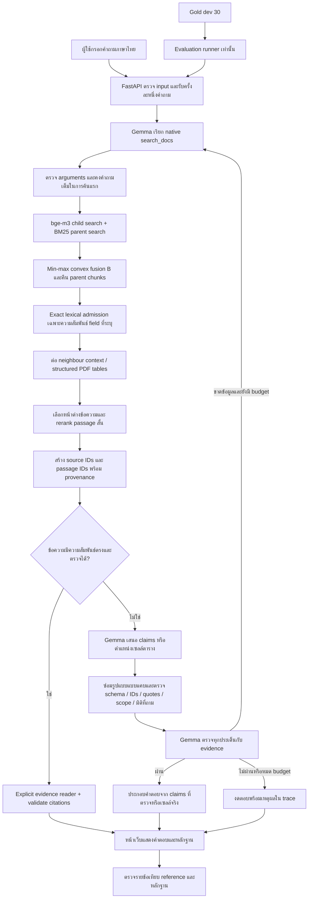

# Workflow และที่มาของแต่ละส่วน

โปรเจกต์แอปอยู่ที่ D:\KMITL\LLMapp\ncd-gemma แยกจาก Thai NCD Guideline QA ต้นทาง ใช้ snapshot ที่ระบุใน provenance/source_snapshot.json ไม่มี runtime import จากต้นทาง และไม่เอา gold ไปเป็นฐานตอบคำถาม

## สิ่งที่นำมาจาก repo เดิม

ต้นทาง https://github.com/Chaiporn2005/thai-ncd-guideline-qa; commit ที่ตรวจตอนนำเข้า 3fb287cdbceab04d13e73f6dfb3bdf5eeb1b6829 แต่ snapshot รวม working-tree artifacts ตาม hash รายไฟล์ จึงไม่อ้างว่า commit นี้เพียงอย่างเดียวสร้างข้อมูลชุดนี้ได้ครบ

| ส่วน | ใช้จริงอย่างไร | ที่ตรวจสอบได้ |
|---|---|---|
| Corpus normalized-v12 | ใช้เอกสารที่ผ่านกระบวนการของต้นทางแล้ว 66 เอกสารที่ index ได้ ไม่ได้ทำ OCR/คัดเอกสารใหม่ทั้งหมด | data/manifests/corpus_normalized-v12_inventory.json |
| Parent-child / small-to-big retrieval | ค้น child 128 tokens แล้วคืน parent 512 tokens ที่ครอบต้นของ child; รวมผลซ้ำด้วย child score สูงสุด | src/ncdqa/retrieval/parent_child.py |
| Dense embeddings | bge-m3 revision 5617a9f61b028005a4858fdac845db406aefb181; ใช้ vectors เดิม 23,819 × 1,024 ไม่สร้าง document embeddings ใหม่ | embed.py, dense.py และ dense index manifest |
| Parent chunks | 4,347 chunks พร้อม document/edition/page/section/population/injection flags | data/index/chunks-v12-t512 |
| Thai lexical retrieval | BM25 บน parent chunks, char3 tokenizer สำหรับภาษาไทยและเก็บ Latin/digits; k1=2.18, b=0.86 | bm25.py, thai_tokens.py |
| Hybrid fusion B | min-max normalize dense/lexical scores แล้ว convex combination alpha=0.6, candidate pool=100 | fusion.py, search.py, configs/retrieval/serve_v1.json |
| Filters | จำกัด document_id, primary_group, document_type, population; ตรวจว่าค่ามีใน snapshot | search.py และ app retrieval wrapper |
| Gold ที่ตรวจไว้ | 177 แถว, gold 162 (dev 106/test 56), rejected 15 ใช้ประเมินอย่างเดียว | data/gold/questions_all_reviewed.jsonl |
| Baseline A/B/C และ scoring | ตรวจ hash และคำนวณ metrics ซ้ำจาก saved hits ทั้ง 6 runs | evaluate.py, data/frozen, reports/retrieval_metrics.json |
| Schemas และ provenance | question/retrieval schemas, document ID, edition และ PDF pages สำหรับตรวจที่มา | schemas/, provenance/source_snapshot.json |

RRF มีในโค้ด fusion ที่คัดลอกมา แต่ระบบปัจจุบันใช้ convex fusion ไม่ใช่ RRF ส่วน C เดิมเป็น B + bge-reranker-v2-m3 บน parent chunks: probe หนึ่งคำถามใช้ราว 110 วินาทีรวม cold load และยังไม่เลือกหลักฐานเป้าหมายใน top 8 แอปจึงนำ model เดียวกัน revision 953dc6f6f85a1b2dbfca4c34a2796e7dde08d41e มาเรียง passage สั้นแทน เป็น app pipeline ใหม่ ไม่ใช่ variant C เดิม และไม่ใช้ frozen C metrics อ้างเป็นผลของแอปใหม่

## สิ่งที่สร้างเพิ่มในแอปนี้

| ส่วน | หน้าที่ |
|---|---|
| Snapshot import และ integrity | คัดลอก allow-list 48 ไฟล์ ตรวจ SHA-256 ไม่เขียนทับไฟล์ที่เปลี่ยน ไม่คัดลอก secrets; data/private/cache ถูก Git ignore |
| OpenAI SDK adapter | ต่อ https://llm.nat-d.uk ใช้ gemma-4-E4B-it, temperature 0; เก็บ key ใน .env ฝั่ง server; bounded HTTP 429 retry และ cache ตาม payload |
| Native tool parser | อ่านทั้ง JSON และ native Gemma tool syntax เป็นข้อมูล ตรวจชื่อ/arguments/duplicate keys; ไม่ eval หรือรันข้อความโมเดล |
| Agent loop | model เรียก search_docs, รับ tool result ด้วย tool_call_id, ค้นเพิ่มหรือเสนอคำตอบ; จำกัดรอบ คำค้น เวลา และ context |
| Query preservation | บังคับการค้นแรกใช้คำถามเต็ม ป้องกันการย่อคำค้นจนเงื่อนไข/กลุ่ม/ปีหาย; ค้นครั้งต่อไปยัง refine ได้ |
| Neighbour context | ต่อข้อความข้างเคียงจาก admitted chunks ของเอกสารและ edition เดียวกัน พร้อม lineage; v27 เก็บท้าย parent ก่อนหน้าได้ถึง 1,600 ตัวอักษรเพื่อรักษาคู่เปรียบเทียบ และรักษาแถว HTML table ที่อยู่ข้าม chunk; ไม่แก้ index หรือคะแนน Hybrid B |
| Exact lexical admission | เมื่อโจทย์ถามว่าต้อง “แยก” field สองตัว เช่น น้ำหนักกับส่วนสูง จึงรับ parent ที่มีความสัมพันธ์สอง field แบบตรงอักขระจาก frozen corpus เพิ่มจากผล dense/BM25 โดยยังใช้ filters เดิม; ไม่ค้นจาก gold และไม่ใช้กับคำถามทั่วไป |
| Passage focus + rerank | เลือกหน้าต่างข้อความด้วย char3 IDF จาก corpus เท่านั้น ไม่อ่าน gold แล้วใช้ cross-encoder เรียงใหม่; เริ่มส่ง 2 passages สำหรับคำถามเชิงคุณภาพสั้น แต่คงทุก passage ที่จัดอันดับไว้เมื่อถามตัวเลขหรือหลายประเด็น ยกเว้นการค้นแถวจำนวน/สัดส่วนหรือขนาด/ความถี่ที่ใช้ 2 passages เพื่อไม่ปนคนละกลุ่ม; ค้นเพิ่มได้ ไม่มี confidence threshold; เก็บ score cache ตาม query/text/model revision |
| PDF tables | PyMuPDF แยก cell geometry/merged headers; ตรวจค่ากับ admitted text; เก็บ derived tables และ hash ของ PDF ต้นทาง 33 ไฟล์; serving ใช้ไฟล์ derived ในโปรเจกต์นี้ |
| Routing ตารางจากข้อความ | ตรวจแถวตัวเลขและหัวคอลัมน์ จำนวน/ร้อยละ หรือชนิดยา/ขนาดยา และตรวจว่าโจทย์ถามแถวจำนวน/สัดส่วนหรือขนาด/ความถี่ เพื่อใช้ prompt อ่านตาราง แม้ PDF extraction ยังไม่มี cell geometry; คำตอบจากเส้นทางนี้ยังเป็นข้อความที่โมเดลสร้างและต้องตรวจความหมาย |
| Table answer renderer | โมเดลเลือก source/แถว/คอลัมน์ ระบบคัด label=value จริง ลดการสลับค่ารวม/นม/อาหาร |
| Passage citations | สร้าง P1/P2 ตามข้อความจริงให้เลือกแทนนับบรรทัด ตรวจ passage/source IDs และความยาว ก่อนคัด quote |
| Claim rendering | รับ claims ที่ผูก source/passages; factual claims ต้องตรงข้อความใน passage โดยเปลี่ยน whitespace ได้ ให้ระบบใส่ marker/citations; v27 ตัด claim ซ้ำที่ไม่ตรง source ถ้ามี claim อื่นที่โมเดลเลือกไว้และคัดตรงจริง จากนั้นยังต้องผ่าน reviewer; คำถามโรคไตกว้างแยกไว้เพื่อถามรายละเอียดเพิ่มได้ |
| Citation recovery | ถ้าโมเดลใช้ legacy line citation ผิดช่วง ซ่อมได้เฉพาะเมื่อข้อความคำตอบทั้งก้อนอยู่ใน source ID ที่โมเดลระบุเพียงแหล่งเดียวและพบตรงเพียงครั้งเดียว; คัดบรรทัดจริงจาก source แล้วตรวจ schema/quote ซ้ำ มิฉะนั้นปฏิเสธ |
| Answer review | Gemma แยกประเด็นและเลือก claim IDs ที่มีจริงแทนเขียนข้อความซ้ำ เพื่อรักษาทั้งค่า กลุ่ม และเงื่อนไข; legacy prose รองรับ answer_quote; ตารางเก็บเส้นทาง renderer เดิม |
| Near-copy alignment | เมื่อคัดข้อความคลาดเล็กน้อย ให้แทนด้วยตัวอักษรจริงจาก passage เดิมเท่านั้น ต้องเหมือนอย่างน้อย 97% และแก้ไม่เกิน 3%; ห้ามเปลี่ยนตัวเลข Latin tokens เครื่องหมายเปรียบเทียบและคำปฏิเสธ ยังต้องผ่าน reviewer ไม่ใช่การยอมรับ paraphrase |
| Dimension guard | ถ้าถามรอบ ต้องไม่ใช้เลขส่วนแทน และสัดส่วนต้องมีหน่วย/ตัวหาร ความถี่ต้องมีจำนวนครั้งหรือช่วงเวลา และคำถามฉลากต้องระบุข้อมูลที่ให้ดู ซ่อมภายใน budget เดิม ไม่มี qid หรือเฉลยในกฎ |
| Clinical scope guard | ก่อนปล่อยคำตอบจาก model/reviewer ตรวจว่ายาที่ถามปรากฏใน citation จริง, ตาราง BMI ตรงประชากรโรคเฉพาะ และคำตอบปริมาณอาหารสำหรับเบาหวานร่วมโรคไตมีหลักฐานครบทั้งสองบริบท; เป็น lexical gate ที่ช่วยจับการถ่ายคำแนะนำข้ามกลุ่ม ไม่ใช่หลักฐานว่า entailment ถูกทั้งหมด |
| Comparison completeness | ถ้าโจทย์เปรียบเทียบการล้างไตสองสภาพ ต้องมีด้านผู้ไหลเวียนคงที่และความดันต่ำจากหลักฐาน; v28 เพิ่ม reader สำหรับคำถามแหล่งโซเดียมที่ต้องเห็นทั้งการเติมเกลือ/สารกันบูดในอาหารกระป๋องและโซเดียมใน MSG |
| Explicit evidence readers v25 | หลัง native search_docs ใช้ `grounded_routes.py` อ่านความสัมพันธ์ที่อยู่ในข้อความตรง ๆ: ชื่อ field บนฉลาก, รอบคะแนน+PDCA ใน source เดียว, BP target เฉพาะกลุ่มพร้อม threshold และอาหาร DASH/CKD ข้ามสอง source; ตรวจ source ID, quote, schema และคำถามก่อนปล่อยคำตอบ ถ้าไม่ครบกลับ agent/reviewer เดิม ไม่มี qid หรือ gold ใน serving |
| Context guards v26 | จำกัด route BP ให้คำถามเป็น proteinuria จริงและคงเครื่องหมายเปรียบเทียบจาก source; route DASH/CKD ไม่ใช้หลักฐานก่อนล้างไตกับผู้ล้างไตหรือปลูกถ่ายไตแล้ว ตรวจ 4 ส่วนก่อนตอบ 1 ใน 4; route CQI ตรวจปีจาก edition แทนปีที่กล่าวถึงในเนื้อหา |
| Evidence readers v29 | หลัง search_docs อ่านตารางสาเหตุ secondary MCD, คู่ทางเลือกฟอกเลือดตามสภาพไหลเวียนจาก edition เดียว และตัวอย่างอาหารสองชนิดพร้อมหน่วย/ค่าจริง; ปฏิเสธถ้าขาด source, edition, quote หรือค่าฝั่งใดฝั่งหนึ่ง |
| Negative-question guards v30 | ปฏิเสธ route เมื่อคำถามเปลี่ยนเป็น primary MCD, ระบบไหลเวียนไม่คงที่ หรือปฏิเสธจำนวนคาร์บที่ route จะตอบ; synthetic counterexamples ตรวจ false positive โดยไม่ใช้ qid ใน serving |
| Greeting intent | คำทักทายล้วนตอบ `out_of_scope` ก่อนโหลด index และก่อนเรียก proxy; คำทักทายที่ตามด้วยคำถามจริงยังผ่าน retrieval ตามปกติ |
| Bounded recovery | ซ่อม schema ด้วย context ใหม่ภายใน budget เดิม อนุญาตไม่เกิน 2 รอบซ่อมหลังมีหลักฐานและต้องเหลือรอบให้ reviewer แยก format repair ที่เก็บ candidate ไว้ให้แก้ กับ completeness repair ที่เริ่มจากคำถามและหลักฐานใหม่เพื่อลดการทวนคำตอบเดิม; รองรับ duplicate property quote/extra closing bracket แบบแคบ ไม่เปลี่ยนค่า; งดตอบเมื่อยังไม่ผ่าน |
| Quantity guard | คำถามกี่/เท่าไรต้องมีค่าจำนวน ไม่นับ citation IDs หรือการทวนปีจากคำถาม; v27 จำกัด “กี่” ให้เป็นคำถามจริง ไม่อ่าน “เกี่ยวข้อง” เป็นคำถามตัวเลข และยอมรับระดับ Roman เช่น III B เมื่อถามระดับหลักฐาน |
| General kidney diet scope | คำถามกว้างให้ตอบแนวทางทั่วไปที่มีหลักฐานและถามข้อมูลเพิ่ม ห้ามเหมารวมข้อจำกัดอาหารเฉพาะบุคคล |
| FastAPI + UI | /api/ask, /api/health, /api/evaluation; คำถามละหนึ่ง request พร้อมแสดงคำตอบ เอกสาร edition หน้า PDF quote และ trace |
| Tests + evaluation | synthetic unit/API tests แยกจากการเรียก proxy จริง; dev 30 qids เดิม ล็อก hash/implementation ก่อนรัน และตรวจคำตอบรายข้อหลังรัน |

การตรวจด้วยโมเดลเดียวกันยังผิดพร้อมกับผู้ตอบได้ การมี source ID/quote จริงจึงไม่ใช่หลักฐานว่าเนื้อหาถูกทั้งหมด และการใช้ dev ชุดเดิมปรับระบบเป็น development tuning ไม่ใช่ independent test

## ลำดับทำงานปัจจุบัน

Configuration ที่ใช้ทดสอบ: สูงสุด 6 model rounds รวม reviewer, 3 searches, top_k ≤ 8 parent hits, 20 source windows, 18,000 context characters, 1400 output tokens, request timeout 45 วินาที และ agent deadline 150 วินาที นับ HTTP retry ใน API attempts แยกจาก model rounds; cache hit ไม่ใช่การสุ่มตอบใหม่ เส้นทาง structured PDF table ข้าม passage reranker เพื่อเก็บหัวคอลัมน์และแถวครบ

## ผลของ v25–v30 และการทดสอบสองชุด

v24 มี 4 ข้อที่สาระไม่ครบหรือหยุดเกินจำเป็น: q061 ค้น field โซเดียมเจอแต่ Gemma พูดเพียงให้อ่านฉลาก; q115 หลักฐานรอบที่ 2/PDCA อยู่หน้าเดียวกันแต่ reviewer สร้าง JSON ผิดและบางรอบตัดสินผิด; q111 ใช้เงื่อนไข “ถ้าไม่อิ่ม” แทน CKD; q106 ใส่เป้าความดันทั่วไป 130/80 ปนกับเป้าเฉพาะกลุ่ม 125/75 การเพิ่ม prompt และ lexical guard อย่างเดียวทำให้บางข้อยิ่งงดตอบ เพราะโมเดลคัดประโยคเดิมซ้ำ จึงเปลี่ยนเฉพาะความสัมพันธ์ที่ตรวจเป็นรูปแบบได้ไปอ่านจากหลักฐานโดยตรง

`grounded_routes.py` ไม่สร้างค่าใหม่จาก gold: ทุก route ต้องมีคำที่ถามและข้อความ source ตรงกัน, เลือกค่า/เงื่อนไขจาก source, สร้าง citation quote จากบรรทัดเดิม และส่งผ่าน `parse_answer`/Pydantic อีกครั้ง กรณีใดจับคู่ไม่ได้จะไม่เข้า route โมเดลยังเป็นผู้เรียก `search_docs` และใช้ agent loop สำหรับคำถามทั่วไป การเปลี่ยนนี้ลดทั้ง false abstention และการปนค่าจาก branch อื่นใน 4 ข้อที่ตรวจ แต่เป็นการ tune บน exposed dev; synthetic tests ที่เปลี่ยนตัวเลขและทดสอบกรณีไม่ควร match ไม่ทดแทน unseen evaluation

v25 บน dev 30 ข้อเดิม: coding-agent review ให้สาระครบ 21 → 25 จาก 25 answerable, false abstention 2 → 0 และงดตรง label ทั้ง 5 ข้อ; `reports/history/v25_gemma_dev_metrics.json` แยก decision accuracy 1.0, citation primary-evidence hit 0.64 และ Character F1 0.4222 ซึ่งไม่ใช่ clinical answer accuracy ผลทุกรุ่นอยู่ `reports/agent_comparison.json` และรายข้อปัจจุบันอยู่ `docs/DEV_COMPARISON_TH.md` ยังมี OCR typo, คำตอบตารางยาว, q118 งดเพราะ review gate และยังไม่มีคำถามใหม่ที่ไม่เคยใช้ปรับระบบให้ตรวจ generalization

ก่อนขยาย route ไปคำถามอื่น ทดสอบ synthetic counterexamples แล้วพบว่า v25 ตอบคำถาม “โปรตีนจากอาหารเกิน 2 กรัม” ด้วยเป้าความดันของผู้มีโปรตีนรั่ว และนำหลักฐาน CKD ก่อนล้างไตไปใช้กับคำถามผู้ล้างไตแล้ว ทั้งสองเป็น false positive แม้ quote และ schema ถูกต้อง v26 จึงเพิ่มบริบทโรค/ระยะจากคำถามเป็น precondition, ตรวจ denominator และปีเอกสาร รวมทั้งคง “น้อยกว่า/ไม่เกิน” ตามต้นฉบับ หากเงื่อนไขไม่ผ่านจะกลับ agent/reviewer เดิม ไม่สร้างค่าทดแทน

v26 รัน dev 30 ข้อเดิมครบ: 25/25 answerable สาระครบตามการตรวจรายข้อ, งดตรง label 5/5, decision accuracy 1.0, citation primary-evidence hit 0.64, Character F1 0.4217 การเปลี่ยนคำตอบมีเฉพาะ q111 ซึ่งระบุ “หากไม่อิ่ม” ให้ตรงหลักฐาน ส่วนอีก 29 ข้อ status/คำตอบ/citations เหมือน v25 HTTP attempts ใหม่ 0 เพราะใช้ cache ของ payload เดิม จึงยืนยัน regression ภายในชุดนี้ได้ แต่ยังไม่ใช่คำตอบสุ่มใหม่หรือผล held-out

ล็อกคำถาม dev อีก 30 ข้อที่ไม่ซ้ำใน `reports/extra_dev_v26_plan.json` ก่อนรัน v26 และตรวจ gold/implementation SHA-256 แล้ว ส่งเฉพาะคำถามกับหลักฐานที่ retrieval พบไป class proxy ตามที่ผู้ใช้อนุญาต ผลตรวจสาระรายข้อถูกหรืองดถูก 19/30 จาก 30 ข้อ: งดเกินจำเป็น 6, ตอบผิด 2, ตอบโดย citation ไม่รองรับ 2, ตอบไม่ครบ 1 รายละเอียดใน `docs/EXTRA_DEV_V26_REVIEW_TH.md` และ `reports/extra_dev_v26_semantic_audit.json` การตรวจนี้เผยจุดบอดของ v26 ที่ชุดเดิม 25/25 ไม่พบ

v27–v28 ปรับเฉพาะ app layer จาก failure analysis: ขยาย HTML table และ parent ข้างเคียง, lexical admission ที่ต้องตรงความสัมพันธ์ field, ให้ passage rerank เก็บบริบทเมื่อโจทย์ถามการแยก/เปรียบเทียบ, ซ่อม citation ที่คัดตรง source อย่างไม่กำกวม, ตัด claim ซ้ำที่ไม่ตรง, เพิ่ม scope/completeness guards และ grounded reader เฉพาะความสัมพันธ์ที่ตรวจได้จากหลักฐาน สร้าง negative/alternate-value tests ควบคู่กัน โดยไม่แก้ gold, original retrieval index หรือ repo ต้นทาง ผล dev 30 ข้อแรก v27 ถอย q108 เหลือสาระครบ 24/25 แล้ว v28 แก้กลับ 25/25; citation primary-evidence hit 0.72 และ Character F1 0.4453 ใน v28 ซึ่งยังเป็น in-sample regression

v28 บน extra-dev ชุดเดียวกับ v26 ได้ 27/30 เหลืองดเกินจำเป็น q006/q107/q110 แม้พบข้อความหลักฐานแล้ว v29 เพิ่มตัวอ่านที่ตรวจแถว Infection ของ secondary MCD, คู่ conventional intermittent hemodialysis กับ SLED และข้าวขาวหนึ่งทัพพีเทียบโคล่าหนึ่งกระป๋อง จึงได้ 30/30 บนชุดที่เปิดผลแล้ว หลังทดลองคำถามสังเคราะห์พบ route ตอบผิดบริบทเมื่อถาม primary MCD หรือไหลเวียนไม่คงที่ v30 จึงเพิ่ม precondition ของคำถามและ negative tests ผล dev 30 แรกยัง 25/25 และ extra-dev 30 ยัง 30/30; answer/status/citations ทั้ง 60 ข้อตรง v29 ทุกข้อและไม่มี HTTP attempts ใหม่ ผลนี้ยืนยันว่า guard ไม่ทำให้ regression ในชุดที่รู้แล้ว ไม่พิสูจน์ generalization การตรวจสาระทำโดย coding agent ไม่ใช่ผู้เชี่ยวชาญอิสระ

ทดลอง response_format แบบ JSON Schema ด้วยข้อมูลสังเคราะห์แล้ว proxy ตอบค่าที่ไม่ตรง enum/type/count ที่กำหนด จึงไม่อ้างว่าใช้ constrained decoding ได้ และยังคงตรวจ schema ฝั่งแอป

## Workflow ของงานพัฒนาและชุดส่ง

1. ตรวจ trace ของข้อผิด แยก retrieval miss / context ถูกตัด / สรุปผิด / schema error
2. แก้ app layer และเพิ่ม synthetic regression tests โดยไม่ใช้ qid หรือเฉลยเป็นเงื่อนไขตอบ
3. ล็อก implementation และ gold hash เป็น dev plan รุ่นใหม่ เก็บผลรุ่นเดิมไว้
4. รัน dev 30 ชุดเดิมครบ ตรวจ automatic metrics แล้วอ่านคำตอบและหลักฐานทีละข้อ
5. รายงานทั้งข้อที่ดีขึ้นและ regression; ทดสอบ API/browser ด้วยคำถามจริงเพิ่มเติม
6. อัปเดต README รายงานและ demo script ให้ตรงผลจริง

สำหรับ Project มี families 1 schema, 2 RAG, 3 evaluation, 4 agentic tool calling และ 6 served UI แล้ว ส่วน public corpus/reproduction, push GitHub, รายละเอียดผู้จัดทำ และวิดีโอ 3–6 นาทีหรือ public deployment ยังเป็นงานชุดส่งที่ผู้ใช้เลือกเตรียมภายหลัง localhost ไม่ใช่ public demo URL
